# Digital Twin — Car Health Monitoring Platform

A full-stack vehicle telemetry observability and diagnostics platform: a deterministic driving simulator streams OBD-II-style telemetry over MQTT into FastAPI + PostgreSQL; a **deterministic rule engine** turns telemetry windows into explainable health scores; a **LangGraph agent** grounds natural-language questions and critical events in that health context plus manufacturer-document **RAG**; and a Next.js workspace visualises telemetry, health, simulation, and workflow execution live.

> **Honest scope note.** Health assessment is a project-defined deterministic rules system (thresholds in `backend/app/intelligence/rules.py`) — it is **not** a machine-learning fault-prediction model and its thresholds are **not** manufacturer-validated. The LLM explains findings; it does not certify diagnoses. See [Current limitations](#current-limitations).

## Key features

| Feature | Status | Implementation |
|---|---|---|
| Telemetry simulator + MQTT ingestion | Implemented | Deterministic drive-cycle engine (`backend/simulator/`), Mosquitto, validated subscriber → PostgreSQL |
| Telemetry REST + live SSE streams | Implemented | `GET/POST …/telemetry`, `…/telemetry/stream`, newest-first pages |
| Deterministic health scoring | Implemented | Statistics → fixed rules → 100-based score, persisted snapshots |
| Health alerts with dedup | Implemented | Warning/critical findings → alerts (`dedup_key`), auto-resolve, ack/resolve API |
| RAG over manufacturer docs | Implemented | Upload → chunk → BGE-M3 embed → pgvector hybrid search → bge-reranker-v2-m3 → cited guidance |
| AI diagnosis agent | Implemented | LangGraph supervisor + tools, cooldown dedup, persisted diagnoses; needs an LLM provider key |
| Workflow Monitor | Implemented | Live event bus + SSE + persisted audit table + filterable UI |
| Auth, roles, ownership | Implemented | JWT access + rotating refresh tokens, `user`/`admin`, per-user vehicle ownership, IDOR tests |
| Simulation control | Implemented | Start/stop/restart simulator runs per vehicle from the UI |
| Predictive-ML fault prediction | **Not implemented** | No sklearn/torch predictor exists in `app/intelligence`; do not claim otherwise |

## Architecture

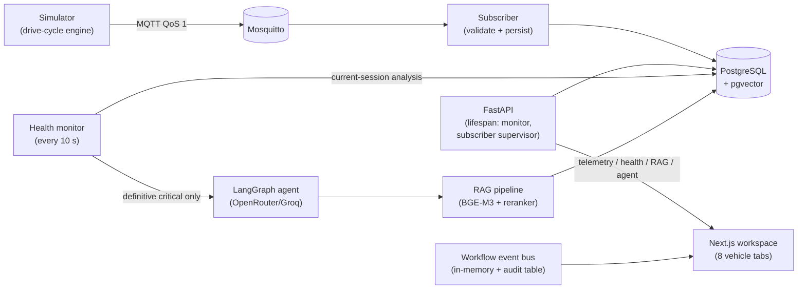

Component details: [`SYSTEM_DOCUMENTATION.md`](SYSTEM_DOCUMENTATION.md) (architecture, API, health engine, RAG, frontend, security, evaluation).

## Technology stack (verified from manifests/lockfiles)

| Layer | Technology |
|---|---|
| Frontend | Next.js 16.3.7, React 19.3, TypeScript 5.9, Tailwind CSS 4.3, TanStack Query 5, Zustand 5, Recharts 3, Radix UI |
| Backend | FastAPI 0.141, Uvicorn 0.53, SQLAlchemy 2.0 (async) + asyncpg, Alembic 1.20, Pydantic 2.13 |
| Data | PostgreSQL 16 + pgvector (HNSW), Mosquitto MQTT |
| AI | LangGraph 1.2 + LangChain, BGE-M3 embeddings (1024-d), bge-reranker-v2-m3, OpenRouter/Groq providers |
| Tests | pytest + pytest-asyncio, Vitest + Testing Library, Playwright |
| Python / Node | Python ≥ 3.12, Node 24 (per CI) |

## Screenshots — application walkthrough

Real captures of the working app (demo data). Each depicts a feature; behavior is proven by the test suites, not by the pictures.

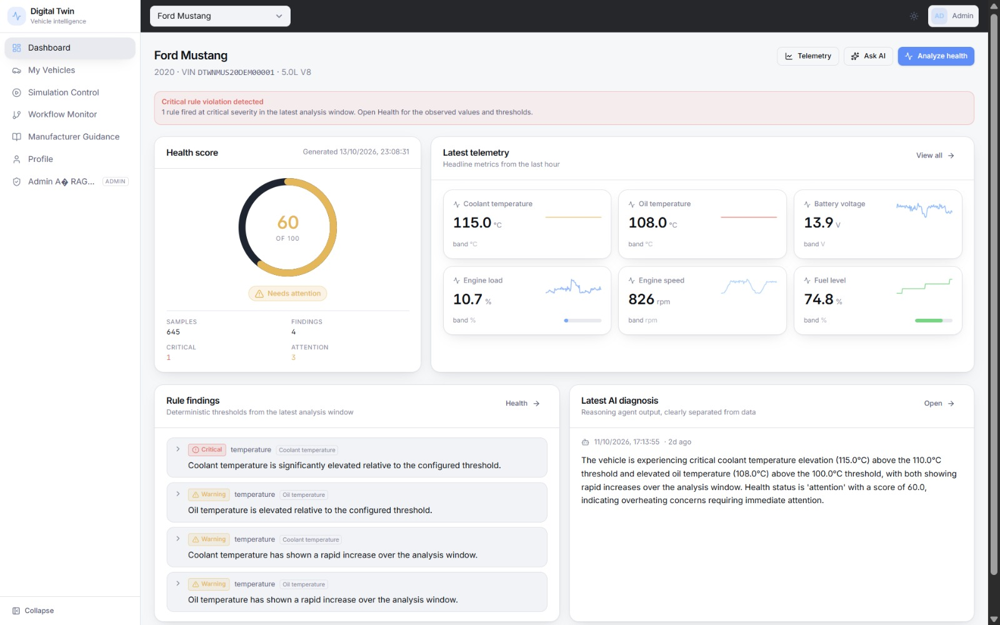
*Vehicle dashboard — health score ring, finding list, live metric tiles, and the agent's summary for a 60/100 “Needs attention” assessment (coolant 115.0 °C vs the 110 °C threshold).*

| Screen | What it shows |
|---|---|
| 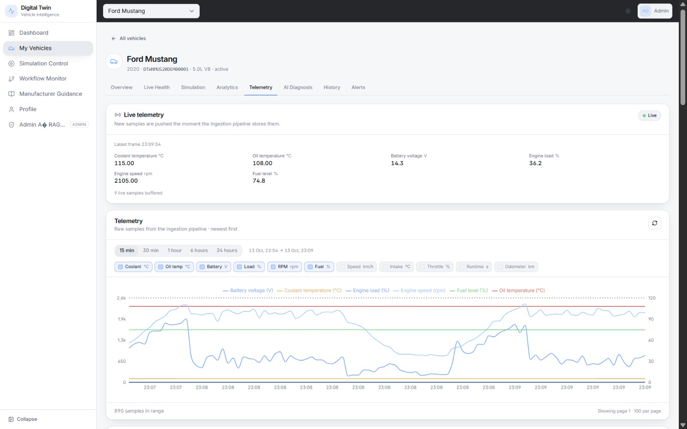 | **Telemetry tab** — live panel (frame clock, buffered count), per-metric toggles, multi-series chart, newest-first samples table. |
| 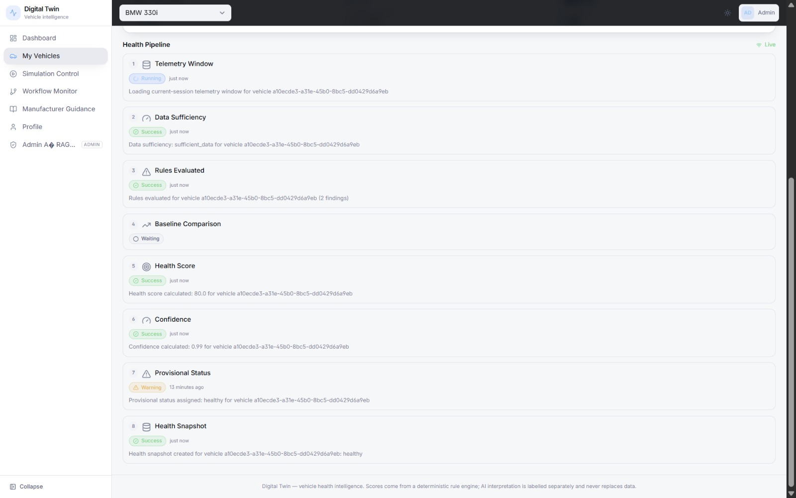 | **Workflow Monitor → Health** — the 8 evaluation stages with statuses (score 80.0, confidence 0.99, provisional warning shown honestly). |
| 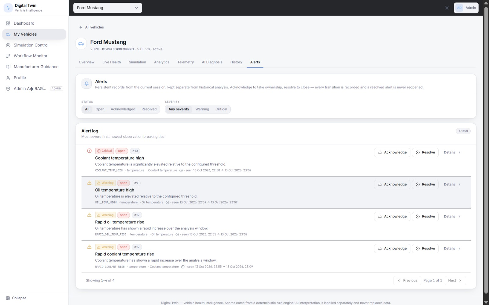 | **Alerts tab** — persistent alerts with severity, open status, recurrence counts (×9–×12), and acknowledge/resolve actions. |
| 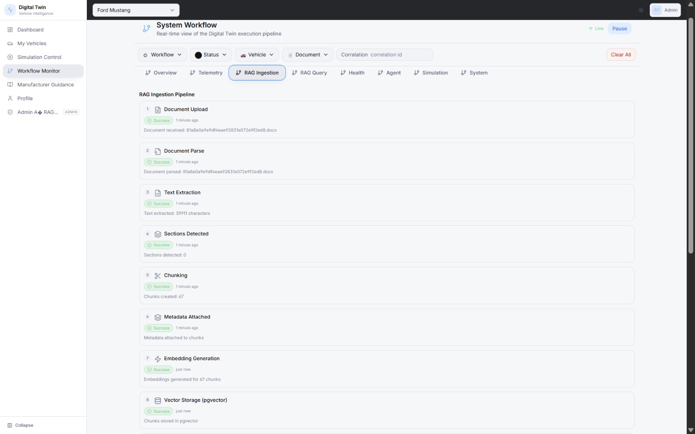 | **Workflow Monitor → RAG Ingestion** — a real `.docx` flowing through parse → 39,911 chars → 67 chunks → embeddings → pgvector. |
| 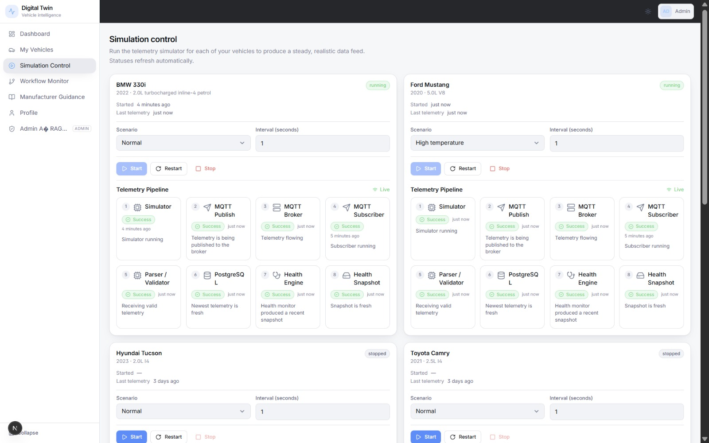 | **Simulation Control** — per-vehicle scenario/interval controls and live 8-stage pipeline steppers (running + stopped vehicles). |
| 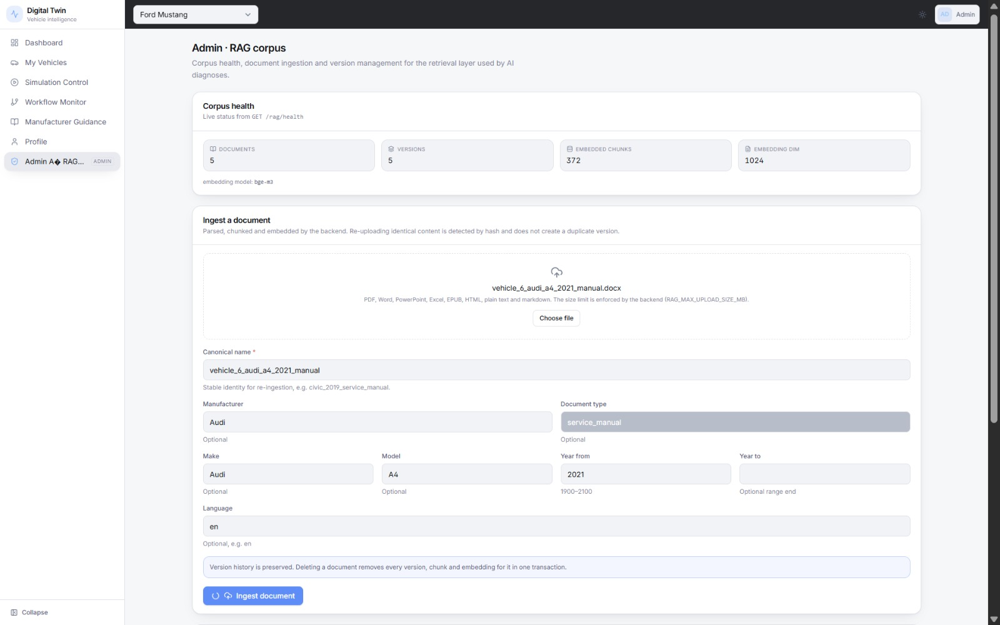 | **Admin RAG corpus** — corpus health (5 documents, 372 chunks, dim 1024) and the metadata-driven ingest form. |

## End-to-end data flows (summary)

1. **Telemetry:** `simulator/` engine → MQTT `vehicles/{id}/telemetry` → subscriber validates (topic↔envelope cross-check, ranges, tz-aware) → `telemetry_records` (dedup on `(vehicle, source_event_id)`).
2. **Health:** window statistics → 14 metric rules + data-state findings → score `100 − capped category penalties`, status ≥80 healthy / ≥60 attention / else critical → snapshot persisted; live runs additionally gate on 30 samples / 30 s / 50% coverage / 15 s freshness.
3. **RAG:** admin upload → parse → chunk → BGE-M3 embed → pgvector hybrid search (top 30) → cross-encoder rerank → threshold → cited guidance. Adapters are cached process-wide; model work runs off the event loop.
4. **Agent:** user question or monitor escalation (definitive critical only) → supervisor → vehicle/health/RAG tools → structured diagnosis persisted; repeats within 300 s with covered rules return the prior diagnosis.
5. **Auth:** register/login → JWT access (20 min) + rotating refresh (30 d); every vehicle/document endpoint enforces ownership; RAG ingestion is admin-only.

## Repository structure

```
backend/                 FastAPI app (app/), simulator/, alembic/ (11 migrations), tests/, scripts/
frontend/src/            Next.js App Router: app/(app)/, components/, hooks/, services/, lib/, stores/
docs/                    Research evaluations, screenshot assets (`assets/`)
scripts/                 dt-start.ps1 / dt-status.ps1 / dt-stop.ps1 (local Mosquitto + API + subscriber)
tasks/                   Historical phased checklists (archived, not live trackers)
data/documents/          Sample RAG corpus documents
```

## Prerequisites

- Python ≥ 3.12, Node 24, PostgreSQL 16 with the `pgvector` extension, Mosquitto broker.
- An LLM provider key only for live AI diagnosis (OpenRouter and/or Groq); everything else runs without one.

## Local installation and startup

```powershell
# 1. Backend dependencies
cd backend
python -m pip install -e ".[dev]"
# For real RAG model inference (optional, ~GBs of weights):
python -m pip install -e ".[rag]"

# 2. Configure (placeholders only — never commit real values)
Copy-Item .env.example .env
# Edit .env: DATABASE_URL, JWT_SECRET, MQTT_*, SIMULATOR_*, LLM_* (only for live diagnosis)

# 3. Database (fresh dev database) + MQTT
alembic upgrade head
# Or manage the local stack with the scripts (from repo root):
#   .\scripts\dt-start.ps1    # Mosquitto + API (:8000) + subscriber
#   .\scripts\dt-status.ps1   # process + service status
#   .\scripts\dt-stop.ps1     # stop everything

# 4. Run the API (from backend/)
python -m uvicorn app.main:app --host 127.0.0.1 --port 8000

# 5. Frontend (new terminal, from frontend/)
npm install        # or: npm ci  (CI uses npm ci on Node 24)
npm run dev        # http://localhost:3000
```

Point the frontend at the API with `frontend/.env.local` (values are examples):

```
NEXT_PUBLIC_API_URL=http://localhost:8000/api/v1
BACKEND_API_URL=http://localhost:8000/api/v1
```

## Database setup and safe test databases

- Fresh dev DB: create an empty PostgreSQL database, set `DATABASE_URL`, run `alembic upgrade head` (11 migrations, incl. pgvector HNSW index — needs the `pgvector` extension).
- **Never run migrations or tests against production.** Backend tests fail closed to `digital_twin_test` on loopback (`backend/tests/conftest.py` refuses hosted DBs):
  ```powershell
  cd backend
  .\.venv\Scripts\python.exe -m pytest -q -p no:cacheprovider
  ```
- Browser E2E uses its own disposable database (`digital_twin_browser_test`) and isolated ports (`npm run test:e2e` boots both servers itself):
  ```powershell
  cd frontend
  npm run test:e2e
  ```

## Test, lint, type-check

```powershell
cd backend
.\.venv\Scripts\python.exe -m pytest -q -p no:cacheprovider  # hermetic suite
.\.venv\Scripts\python.exe -m ruff check .
.\.venv\Scripts\python.exe -m ruff format --check .
cd ..\frontend
npm run typecheck   # tsc --noEmit
npm run lint        # eslint .
npm run test        # vitest run
npm run test:e2e    # playwright (isolated stack)
```

## Simulator and MQTT

```powershell
# Via scripts (repo root): .\scripts\dt-start.ps1  (starts broker, API, subscriber)
# Simulator scenarios: SIMULATOR_SCENARIO=normal|high_temperature|low_battery|high_engine_load
# Drive it from the UI: vehicle → Simulation tab (start/stop/restart), or per-docs runbooks.
```

API surface: `GET /api/v1/health`, `/health/db`, `/health/deployment`, auth (`/auth/*`), vehicles, telemetry (+`/stream`), health (`/analyze`, `/history`, `/live`), historical-analytics, agent (`/query`, `/events/critical`, `/dashboard`, `/diagnoses*`), simulation, RAG (`/rag/search`, `/rag/health`), admin RAG documents, alerts, workflow (`/events/recent`, `/events/stream`, `/state`, `/status`). Live OpenAPI: `http://localhost:8000/docs`.

## Evaluation and analysis (synthetic — not real-world validation)

The frozen protocol (`docs/research/accuracy_evaluation_plan.md`) tests the deterministic pipeline against harness-injected faults on disposable infrastructure. Headlines from `docs/research/evaluation_final_report.md`:

| Question | Result |
|---|---|
| Fault detection, steady view (20 episodes) | accuracy / macro-F1 **1.000**; normal control raised 0 alert-worthy findings |
| Full view (warm-up included) | accuracy **0.250** — cold-start warm-up trips rapid-rise rules in every episode (reported, not suppressed) |
| Alert lifecycle (12 episodes) | episode recall 100%, precision 75%; 0 duplicate rows; publish→alert p50 21.8 ms |
| Latency | publish→persist p50 3.9 ms; engine analyse p50 1.2 ms; monitor pass p50 16.1 ms |
| AI-diagnosis correctness | **NOT EVALUABLE** — no expert-labelled reference diagnoses exist |
| Robustness | 10/10 injected-fault cases (duplicates, gaps, malformed payloads, DB failure, broker restart) |

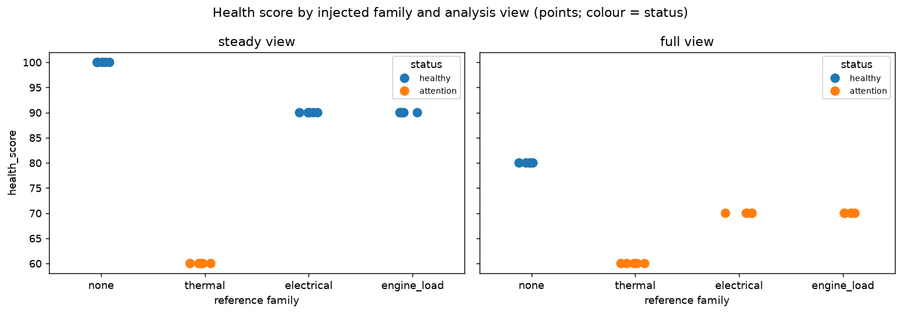
*Thermal episodes score 60/attention; electrical and load episodes score 70–90; the full view exposes warm-up sensitivity.*

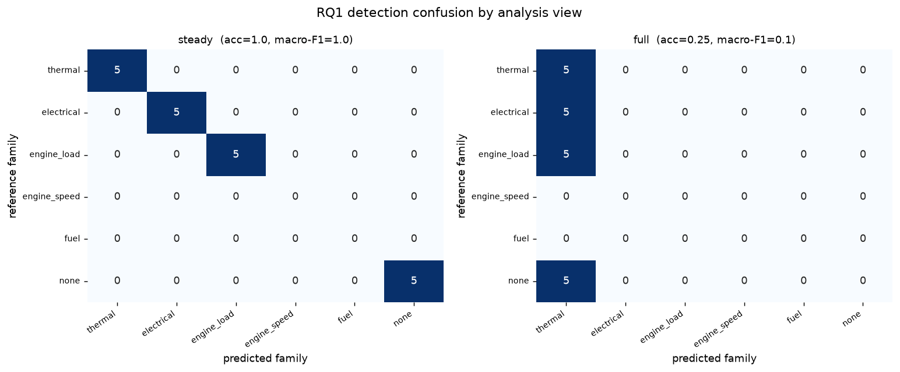
*Perfect diagonal on steady (acc 1.0, macro-F1 1.0); everything collapses to “thermal” on full (acc 0.25) from cold-start rapid-rise transients.*

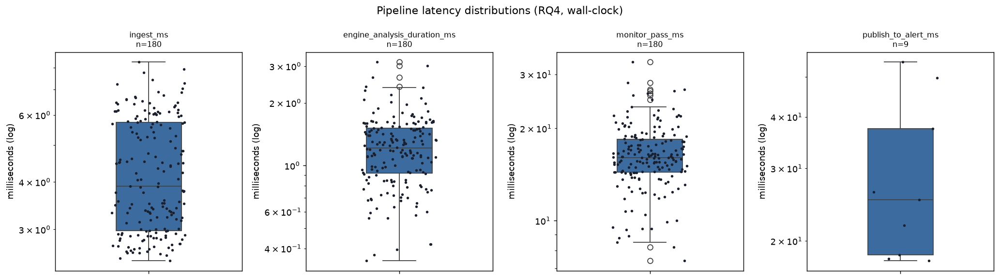
*Wall-clock latencies (log scale): ingest, engine analysis, monitor pass (n=180), publish-to-alert (n=9).*

All figures: `docs/research/results/synthetic-eda-v1/figures/` (11 plots) and `docs/research/results/synthetic-pipeline-v1/figures/`; metrics and provenance JSON sit beside each report. Reference is the injected scenario — none of this establishes real-world accuracy.

## Troubleshooting

| Symptom | Likely cause / fix |
|---|---|
| Frontend shows “Cannot reach the Digital Twin API” | Backend down or `NEXT_PUBLIC_API_URL` wrong; check `dt-status.ps1` and the API port |
| Agent diagnosis very slow first time | Cross-encoder/embedding weights loading (GBs) + CPU inference; watch for `weights loaded … elapsed_ms` in API logs; adapters are cached after first load |
| `alembic upgrade head` fails on `vector` | PostgreSQL lacks the pgvector extension — install it (CI uses `pgvector/pgvector:pg16`) |
| MQTT subscriber “not running” | Mosquitto not started or wrong `MQTT_BROKER_HOST/PORT`; the API still serves, statuses report degraded |
| E2E fails with “another dev server running” | Next.js allows one dev server per project dir — the suite boots its own; stop the local `next dev` or use `E2E_REUSE_SERVERS=1` |
| RAG search 503 “disabled” | `RAG_ENABLED=false`, or weights missing and no stub configured |

## Security notes

- Copy `backend/.env.example` to `backend/.env` (both git-ignored) and generate a long random `JWT_SECRET`; keys stay in environment, never in code (verified: no hardcoded secrets in `backend/app`).
- Workflow metadata is sanitized (`[REDACTED]` for password/token/key-like fields); DB errors return generic 500s; auth headers are never logged.
- Rate limiting guards auth endpoints; CORS defaults to `http://localhost:3000`.

## Current limitations

- Health thresholds are project-defined, not manufacturer-validated; the score is a heuristic, not a calibrated probability.
- No ML fault-prediction model exists; “prediction” language should not be used.
- Some rules (rpm > 4500, fuel < 15/5%, battery < 10.5 V) cannot fire under the built-in simulator — only via hand-posted REST data.
- CPU-only reranking of full-length chunks is slow (tens of seconds); GPU not wired.
- `ruff format --check` currently reports files needing reformat (CI gate at risk — see audit).
- No production deployment target is defined in-repo (no published Docker image registry / hosting).

## Roadmap

Prioritized, proposal-status improvements: dependency advisory fixes, boundary-rule tests, agent cooldown tests, REST/MQTT validation alignment, an isolated load harness with SLOs, manufacturer-threshold calibration. Full detail: [`SYSTEM_DOCUMENTATION.md`](SYSTEM_DOCUMENTATION.md) §18.

## Contribution and license

No `CONTRIBUTING` guide, code of conduct, or license file was found in the repository — add one before accepting external contributions (UNVERIFIED: confirm with the owner which license applies). Follow the existing patterns: hermetic tests, no production writes, sanitized logs.
