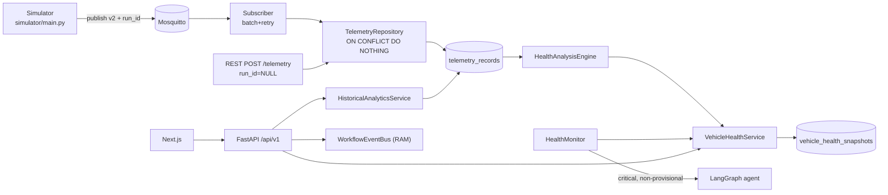
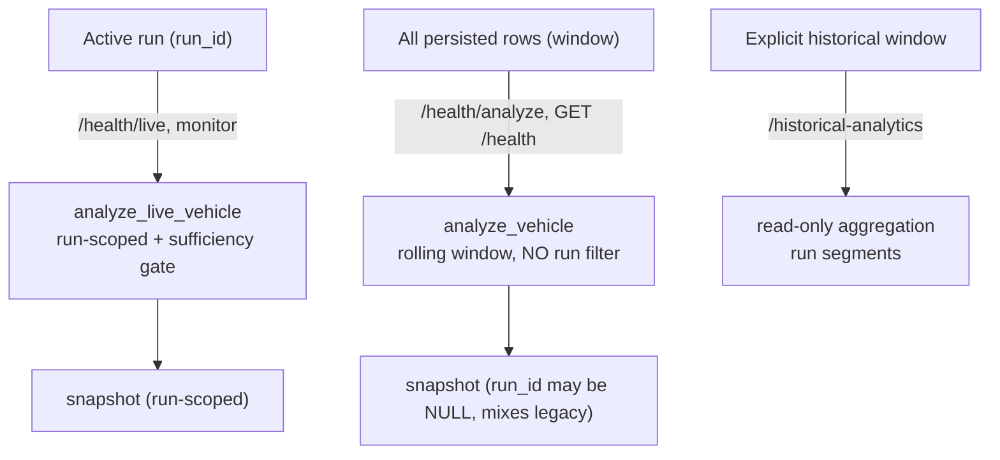

# Digital Twin — Architecture Reference (supporting artifact)

**Companion to:** `DIGITAL_TWIN_SYSTEM_AUDIT_2026-10-11.md`
**Date:** 2026-10-11 · **Repo:** `C:\Users\Abhishek\Desktop\Digital Twin`
**Label key:** Verified (source/runtime) · Inferred · Not verified

This document is a compact architecture map of the *current working tree* (which includes the uncommitted live/historical separation feature). It is evidence-based; paths are repo-relative.

---

## 1. Technology stack (Verified)

| Layer | Technology | Entry point |
|---|---|---|
| API | FastAPI (async), Pydantic v2 settings | `backend/app/main.py:123` |
| Persistence | PostgreSQL (Supabase, SSL), SQLAlchemy 2 async | `backend/app/core/database.py`, `backend/app/models/*` |
| Migrations | Alembic (head `c3f7a2d5e9b1`) | `backend/alembic/versions/*` |
| Messaging | MQTT / Mosquitto (aiomqtt) | `backend/app/mqtt/client.py`, `subscriber.py` |
| Simulator | Python process per vehicle | `backend/simulator/main.py` |
| Health engine | Pure Python (statistics/rules/scoring) | `backend/app/intelligence/*` |
| Agent / RAG | LangGraph/LLM + pgvector | `backend/app/agent/*`, `backend/app/rag/*` |
| Frontend | Next.js (App Router) + React Query | `frontend/src/app/**` |

---

## 2. Component responsibilities

### Backend lifecycle — `backend/app/main.py:55-95`
`lifespan` → `configure_logging` → `init_engine` → `check_database_connection` (warn-and-serve if down) → start **one** health monitor (`_start_health_monitor`, `:98-120`) → `simulation_manager.cleanup_stale()` (:70) → ensure MQTT subscriber supervisor. Shutdown cancels the monitor and closes resources.

### Config — `backend/app/core/config.py:10-160`
Pydantic `BaseSettings` from `.env`. Notables: `app_env` default `"development"` (`:23`); `health_analysis_window_minutes=15` (`:51`); live sufficiency gates `live_health_minimum_samples=30`, `_duration_seconds=30`, `_coverage=0.5`, `_max_sample_age_seconds=15` (`:65-68`); monitor `enabled=True`, `interval=10s`, `min_seconds=60s`, `max_vehicles=25` (`:71-74`); MQTT defaults localhost:1883 (`:32-33`).

### Ingestion
- **Subscriber** `backend/app/mqtt/subscriber.py`: subscribe `{prefix}/+/telemetry`; batch ≤ `mqtt_batch_max_messages=250` / `mqtt_batch_flush_seconds=0.25` (`:128-160`); validate; bounded retry (`:211-296`); persist via service.
- **Schema** `backend/app/mqtt/schemas.py`: v2 envelope (`schema_version`, `event_id`, `vehicle_id`, optional `simulation_run_id`, tz-aware `timestamp`, `telemetry`). Naive timestamps rejected.
- **Repository** `backend/app/repositories/telemetry_repository.py`: `insert_many` uses `pg_insert(...).on_conflict_do_nothing()` (`:47-62`); idempotent via partial unique index.

### Health engine — `backend/app/intelligence/*`
- `engine.py`: orchestration, data-quality, live-sufficiency gate, windowed vs live analysis.
- `statistics.py`, `trends.py`, `baselines.py`, `rules.py`, `scoring.py`, `context.py`, `models.py`.
- Service layer `backend/app/services/vehicle_health_service.py`: windowed `analyze_vehicle` (no run filter) and run-scoped `analyze_live_vehicle` (`exclude_run_id` baseline). Persists immutable snapshots.

### Health monitor — `backend/app/services/health_monitor.py`
Background loop; selects vehicles with newer telemetry (`older_than=60s`); resolves the active run (skips if none, `:201-208`); live analysis; escalates **critical & non-provisional** to the agent (`:375-417`).

### Historical analytics — `backend/app/services/historical_analytics_service.py` + route
Read-only, validated, UTC-aware windows (1h/24h/7d/30d/90d/custom); run-boundary segments; time-bucketed counts; snapshot history.

### Workflow observability
- `backend/app/services/workflow_event_bus.py`: in-memory ring buffer, capacity 500, non-blocking publish, SSE subscribe. **Not persisted.**
- `backend/app/services/telemetry_pipeline_state.py`: derives 8 stages from real signals (freshness, subscriber health, snapshot age).
- `backend/app/services/telemetry_freshness.py`: `STALE_AFTER_SECONDS=30`; snapshot staleness = monitor_min + interval + 30.

### Simulation — `backend/app/services/simulation_manager.py`
One supervised process per vehicle; `run_id = uuid4()` per spawn; env `SIMULATOR_RUN_ID`; PID marker files; `cleanup_stale()` on startup; **run state in memory**.

### Frontend — `frontend/src/**`
Seven tabs (Overview, Health, Simulation, Analytics, Telemetry, AI Diagnosis, History). Health uses `GET /health`; Simulation uses `GET /health/live`; Analytics uses `GET /historical-analytics`.

---

## 3. Data-flow diagrams

### 3.1 End-to-end

### 3.2 Live vs historical

---

## 4. Technology / deployment observations

- **DB is remote (Supabase) over SSL** — batching exists specifically to absorb remote latency.
- **Simulator uses anonymous local Mosquitto** in the audited dev setup (`127.0.0.1:1883`).
- **Run identity is not persisted in a dedicated table** — it lives on telemetry rows and in the manager's memory (lost on restart; orphaned processes cleaned via PID files).
- **Workflow bus is process-local** — observability does not survive restart.
- **No alert storage layer exists** (findings live inside snapshot JSON).

---

## 5. Component ownership / clarity

| Concern | Owner module | Coupling |
|---|---|---|
| Telemetry validation | `app/mqtt/schemas.py` | shared by subscriber + simulator |
| Telemetry persistence | `app/repositories/telemetry_repository.py` | used by subscriber + REST + analytics + health |
| Health formulas | `app/intelligence/*` | pure, transport-agnostic |
| Run identity | `app/services/simulation_manager.py` + telemetry column | no dedicated table |
| Live gate | `app/intelligence/engine.py:91-149` | consumed by service + monitor |
| Freshness thresholds | `app/services/telemetry_freshness.py` | shared by simulation + workflow state |

**Inferred:** the deterministic engine's purity (no DB/MQTT) is deliberate and enables identical behavior across MQTT, REST, replay and tests.
