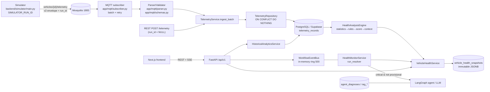
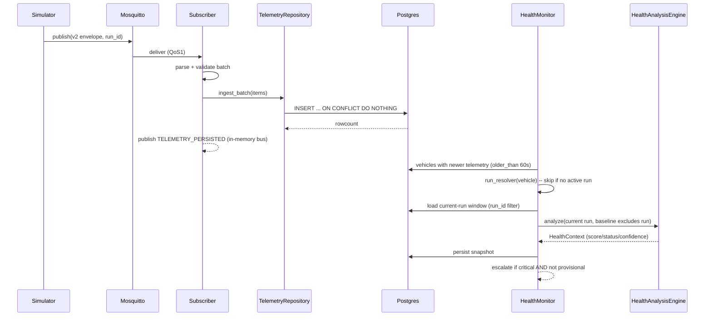

# Digital Twin — Comprehensive System Workflow and Health Report Audit

**Date:** 2026-10-11
**Auditor:** automated senior-architect / backend / data / QA / security review
**Repository:** `C:\Users\Abhishek\Desktop\Digital Twin`
**Branch/HEAD:** `main` @ `3f53a89` (working tree contains uncommitted feature work — see *Limitations*)
**Runtime window:** live probes captured ~2026-10-11 06:27–06:41 UTC (≈12:00–12:10 local, UTC+05:30)

> Evidence labels used throughout: **Verified** (read from source/runtime), **Inferred** (consistent with evidence but not directly proven), **Not verified** (could not confirm), **Defect confirmed** (reproduced or incontrovertibly evidenced).

---

## 1. Executive summary

The system is a **FastAPI + PostgreSQL/Supabase + MQTT + Next.js** vehicle-health platform with four largely independent pipelines: telemetry ingestion (simulator → MQTT → subscriber → Postgres), a deterministic health engine (statistics → rules → score → snapshot), a background health monitor that escalates critical results into a LangGraph/LLM diagnosis agent, and a workflow-observability bus.

**What works (Verified).** The deterministic engine is coherent and reproducible: the score, status, penalty capping, coverage and confidence formulas are centralized and **reproduce the live BMW report exactly** (score 60 from a 60→40-capped temperature penalty; confidence 0.5391 from the documented formula). Telemetry ingestion is batched, retried and idempotent via a partial unique index. Live current-session analysis (`GET /health/live`) genuinely isolates the **active run** and applies an honest sufficiency gate; the background monitor also evaluates current runs only and never escalates provisional/stale evidence. Historical analytics is a separate, read-only, validated, UTC-aware endpoint with run-boundary segments. The backend test suite passes (674 collected, **664 passed / 10 skipped / 0 failed**) and the frontend is green (**151 passed**, `tsc` clean).

**What is wrong or risky (Verified).** The product does **not** fully implement the stated live-vs-historical separation end-to-end:

1. **The Health tab shows a historical, run-mixing snapshot as "Vehicle health".** `GET /health` returns the *latest persisted snapshot* regardless of window or run; the last snapshot for the BMW was a **1440-minute** analysis whose `simulation_run_id` is `NULL` because it spans **15 390 legacy (`NULL`-run) rows** plus the recent run. There is no freshness banner, no "historical window" label, and the on-screen "Analysis window" selector defaults to **1 hour** while the displayed report is a **24-hour** snapshot. (P1)
2. **The `POST /health/analyze` window path has no run filter** (`get_recent_telemetry` without `run_id`), so any windowed analysis can fuse historical records into a purported health verdict. (P1)
3. **`GET /health/live` performs writes** — it persists a fresh `HealthSnapshot` on every request — i.e. a side-effecting GET that races the monitor and inflates the snapshot table (155 snapshots for one vehicle). (P2)
4. **There is no alert subsystem at all** — no alert model/table, no acknowledgement, resolution, or notification delivery. "Alerts" are transient findings, in-memory workflow events, and agent escalations. (P1 for requirement coverage)
5. **Workflow events are not persisted** (process-local ring buffer, capacity 500); history is lost on restart and cannot be audited. (P2)

No **P0** was confirmed in the current local configuration. The default JWT-secret fail-open (empty secret accepted whenever `APP_ENV` is left at its default `"development"`) is a real but configuration-dependent security weakness (P2).

**BMW 330i (`a10ecde3-…`).** The screenshot values are explained and largely confirmed against the database: score **60**, status **needs attention**, confidence **0.54**, samples **17 426**, coverage **20%**, coolant **115.0 °C** vs threshold **110.0 °C**, generated **06:11:45Z** (11:41 local). The report is a **historical 24-hour window snapshot**, **not** a live-session assessment; the newest telemetry sample was already **~17 minutes stale** at audit time, and the coolant reading predates the audit.

---

## 2. Scope, methodology, and limitations

### Methodology
- **Source inspection** of backend application, models, migrations, services, MQTT layer, simulator, agent/RAG, frontend components/hooks/services/proxy routes, and tests.
- **Live OpenAPI** fetched from `http://127.0.0.1:8000/openapi.json` (34 paths) and compared against the source routes.
- **Live API probes**: `GET /health`, `GET /health/db`, `POST /auth/login`, `GET /workflow/status`, `GET /workflow/state`.
- **Read-only database probes** against the configured Postgres/Supabase instance (counts, indexes, latest rows, snapshot context JSON). No writes.
- **Executed tests**: full backend pytest suite and frontend vitest + `tsc`.
- **Cross-checked** the audit prompt's screenshot observations against live data.

### Limitations / caveats
- The working tree contains **uncommitted feature work** (the live/historical separation feature). The audit describes the **current working tree**, which is what the running backend serves. `git status --short` shows ~40 modified files.
- The API prefix is `/api/v1`; the prompt's `/openapi.json` was reachable at the API root.
- `mqtt_e2e`-marked tests are excluded by `addopts` (`-m 'not mqtt_e2e'`), so broker round-trips are **not** covered by the executed suite.
- No browser was driven; UI conclusions are from source + API/DB evidence. Screenshot values were treated as *observations* and independently verified where possible.
- ESLint was not re-run this session (reported clean earlier); `tsc` and vitest were re-run (Section 14).
- Secrets/personal data are not reproduced. Credentials are referenced only by name.

---

## 3. System architecture

### 3.1 Inventory (Verified)

| Subsystem | Entry point | Purpose | Key models/tables | Failure modes |
|---|---|---|---|---|
| Backend app | `backend/app/main.py:123` (`app`), lifespan `:55-95` | API + lifecycle | — | DB unreachable at startup (warn, serve degraded) |
| Config | `backend/app/core/config.py:10` | env settings | — | fail-open JWT secret in dev |
| DB layer | `backend/app/core/database.py`, `app/dependencies/database.py` | engine/session | — | remote latency, semaphore timeouts |
| Auth | `app/api/routes/auth.py`, `app/core/security.py`, `app/dependencies/auth.py` | JWT + rotating refresh | `users`, `refresh_tokens` | token replay, weak secret |
| Vehicles | `app/api/routes/vehicles.py`, `app/models/vehicle.py` | ownership CRUD | `vehicles` | tenancy bypass if unchecked |
| Telemetry | `app/api/routes/telemetry.py`, `app/mqtt/*`, `app/services/telemetry_service.py`, `app/repositories/telemetry_repository.py` | ingest/list/stream | `telemetry_records` | duplicate delivery, gaps |
| Simulator | `backend/simulator/main.py`, `app/services/simulation_manager.py` | publish + supervise | (in-memory run state) | orphan processes, crash |
| Health engine | `app/intelligence/*`, `app/services/vehicle_health_service.py` | deterministic analysis | `vehicle_health_snapshots` | truncation, run mixing |
| Health monitor | `app/services/health_monitor.py` | background eval + escalation | snapshots, agent | DB errors, skip no-run |
| Historical analytics | `app/services/historical_analytics_service.py`, `app/api/routes/historical_analytics.py` | read-only aggregation | telemetry + snapshots | large windows, gaps |
| Workflow observability | `app/services/workflow_event_bus.py`, `app/services/telemetry_pipeline_state.py`, `app/api/routes/workflow.py` | events + derived state | (in-memory) | not persisted |
| Agent / RAG | `app/agent/*`, `app/rag/*` | LLM diagnosis, docs | `agent_diagnoses`, `rag_*` | provider errors |
| Frontend | `frontend/src/app/**`, `frontend/src/components/**`, `frontend/src/services/**`, `frontend/src/hooks/**` | Next.js UI | — | stale/contradictory display |

### 3.2 Architecture diagram



---

## 4. End-to-end telemetry workflow

### 4.1 Happy path (Verified)

Producer: `backend/simulator/main.py` builds one `TelemetryMessage` per tick (`:54-62`) with `schema_version=2`, `event_id=uuid4().hex`, `SIMULATOR_VEHICLE_ID`, `SIMULATOR_RUN_ID`, timezone-aware `timestamp`, and `telemetry` values. Envelope schema: `app/mqtt/schemas.py:56-71` (`simulation_run_id: UUID | None`; naive timestamps rejected at `:68-71`). Topic pattern `vehicles/{vehicle_id}/telemetry` (`app/mqtt/topics.py`).

Consumer: `app/mqtt/subscriber.py`:
- subscribes with QoS (`mqtt_qos=1`), reconnect loop with exponential backoff (`:61-82`).
- **batches**: collects up to `mqtt_batch_max_messages=250` or flushes within `mqtt_batch_flush_seconds=0.25` (`:128-160`).
- validates each message (parse failures emit `TELEMETRY_VALIDATION_ERROR`, skipped — `:171-188`).
- persists the batch via `TelemetryService.ingest_batch` (`:297-315`), with bounded retry (`mqtt_message_retry_attempts=3`, `:211-296`).

Idempotency: `TelemetryRepository.insert_many` performs `pg_insert(...).on_conflict_do_nothing()` (`app/repositories/telemetry_repository.py:47-62`), backed by the **partial unique index** `uq_telemetry_records_vehicle_source_event` on `(vehicle_id, source_event_id) WHERE source_event_id IS NOT NULL` (`app/models/telemetry.py:78-84`). Duplicate deliveries are silently skipped; `rowcount` reports the true insert count.

Timestamps/timezone: all timestamps are `DateTime(timezone=True)`; the simulator sends UTC (`_now_utc()`); `created_at` is `server_default=func.now()`.

Run-id propagation: `simulation_manager._build_command_and_env` sets `SIMULATOR_RUN_ID` (`app/services/simulation_manager.py:656`); the simulator echoes it; the subscriber copies `envelope.simulation_run_id` into the row (`subscriber.py:305`). Messages without it persist **`NULL`** (never invented).

Workflow events emitted during ingestion: `MQTT_RECEIVED` (`subscriber.py:98`), `TELEMETRY_PARSED` (`:190`), `TELEMETRY_VALIDATION_ERROR` (`:177`), `TELEMETRY_PERSISTED` (`:239`), `TELEMETRY_PERSIST_STARTED`(error) (`:278`).

### 4.2 Alternate ingestion / analysis paths (Verified)
- **REST ingestion**: `POST /api/v1/vehicles/{vehicle_id}/telemetry` (`app/api/routes/telemetry.py:26-40`) via `TelemetryCreate`. This path carries **no run id** → rows persist with `simulation_run_id = NULL` (treated as legacy provenance).
- **SSE telemetry stream**: `GET /vehicles/{id}/telemetry/stream` (`telemetry.py:121-161`) polls `list_since(after=cursor)` on each short-lived session and emits JSON frames; idle → `: ping`.
- **Direct API-triggered analysis**: `POST /health/analyze` (`app/api/routes/vehicle_health.py:24-45`) re-runs the deterministic engine on demand and **persists a new snapshot**.
- **Background monitor analysis**: the monitor calls the current-run live path (Section 10).

### 4.3 Duplicate / out-of-order / delayed / restart handling
- **Duplicates**: idempotent insert (above).
- **Delayed / backlog**: batching prevents a backlog from being persisted "already older than the health window" (documented rationale `subscriber.py:129-138`).
- **Out-of-order**: the health engine computes and reports `timestamp_order_valid` (`app/intelligence/engine.py:74-76`); the frontend surfaces a warning when false (`vehicle-health-view.tsx:199-204`). Rows are ordered by `(timestamp, id)`, so equal timestamps are stable.
- **Subscriber restart**: reconnects with backoff; a gap appears in telemetry and is reported as `TELEMETRY_GAP` (info) by the rule engine (`app/intelligence/rules.py:290-305`).
- **Simulator restart while older telemetry remains**: new run id; older rows retained with their own run id (Section 5). A run with no persisted rows yet yields `no_data`.

### 4.4 Telemetry sequence diagram



---

## 5. Simulation lifecycle and run isolation (Verified)

- **Start**: `SimulationManager.start` (`simulation_manager.py:243`) spawns `simulator.main` with a **new** `run_id = uuid4()` (`:535`) and env `SIMULATOR_RUN_ID` (`:656`). One process per vehicle, supervised; PID markers `{runtime_dir}/{vehicle_id}.{pid}.pid`; logs `{vehicle_id}.log`.
- **Active run**: `active_run_id` (`:434-446`) returns `instance.run_id` while the instance exists.
- **Status/run-id exposure**: `_to_status` (`:676-696`) exposes `run_id` **only** while status ∈ {starting, running, stopping}; stopped/error → `None`.
- **Stop**: `stop` (`:307`) terminates and finalizes; run id no longer exposed. DB telemetry **retains** the run id (historical identity is preserved).
- **Restart**: `restart` (`:364`) stops then spawns a **new** run id — a restart never inherits the previous run's identity.
- **Unexpected stop**: `_supervise`/`_record_exit` (`:573-618`) records exit; status becomes `error` with a reason derived from the log tail.
- **Backend restart**: **run state is in-memory** (`_instances` dict, `_Instance` dataclass) — it does **not** survive. On startup `cleanup_stale()` (`:454`, wired at `main.py:70`) terminates orphaned simulator PIDs found via marker files. **Inferred:** this is the intended recovery model.
- **Previous run for historical analytics**: available — `historical_analytics_service` groups by persisted `simulation_run_id`, including a legacy `NULL` segment (`app/repositories/telemetry_repository.py:173-205`).
- **Physical vehicles / no run id**: rows persist with `NULL`. `GET /health/live` returns `no_session`; the monitor **skips** the vehicle (`health_monitor.py:201-208`). Only the windowed historical analysis applies.
- **Concurrent simulators**: the manager keeps one instance per vehicle, and `start` guards against double-spawn. **Not verified** at the OS level that two externally-launched simulators for the same vehicle cannot both publish; the run resolver would follow the manager's tracked instance.

**Run-isolation guarantee (current session):** `analyze_live_vehicle` filters current-run rows by `run_id` and loads the baseline with `exclude_run_id` (`app/services/vehicle_health_service.py:195-229`) — a current session is never counted as its own baseline, and historical samples are never fused into current-run statistics. **Verified.**

---

## 6. Health-engine formulas and report generation

### 6.1 Pipeline (Verified)
`VehicleHealthService.analyze_vehicle` (windowed) / `analyze_live_vehicle` (run-scoped) → `HealthAnalysisEngine.analyze` (`app/intelligence/engine.py:158-325`) → statistics → trends → baselines → rules → score → context (`app/intelligence/context.py`) → snapshot persisted as immutable JSONB (`app/models/health_snapshot.py:18-23`).

### 6.2 Metric set and statistics
`SUPPORTED_METRICS` = rpm, speed, engine_load, coolant_temperature, oil_temperature, battery_voltage, fuel_level, intake_air_temperature, throttle_position, engine_runtime, odometer (11; confirmed by live context which carried 11 statistics/trends). Per-metric min/max/mean/median/std_dev/last/count via `app/intelligence/statistics.py`.

### 6.3 Analysis window
- **Windowed** (`analyze_vehicle`): `window_end = now`, `window_start = now − window_minutes` (`vehicle_health_service.py:113-115`), default `health_analysis_window_minutes = 15` (`config.py:51`), overridable 1–1440 by the client.
- **Live** (`analyze_live_vehicle`): `outer_start = now − 15 min`; `session_start = max(outer_start, first current-run sample)`; window = `[session_start, now]` (`:187-213`).

### 6.4 Score (Verified formula)
`app/intelligence/scoring.py`:
- Start **100**; penalties **info 0, warning 10, critical 30** (`FINDING_PENALTIES`, `:39`).
- Penalties accumulate **per category**, each **capped at 40** (`CATEGORY_PENALTY_CAP`, `:42`).
- `score = clamp(100 − Σ per-category capped penalty, 0, 100)` (`:94-95`).
- Status thresholds (`:45-46, :49-56`): `≥80 healthy`, `60–79.99 attention`, `<60 critical`; insufficient data → `unknown`.

**Reproduction (BMW):** findings = `COOLANT_TEMP_HIGH` (critical, category *temperature*) + `OIL_TEMP_HIGH` (warning, *temperature*) + `RAPID_COOLANT_RISE` (warning, *temperature*) + `RAPID_OIL_TEMP_RISE` (warning, *temperature*) + `LOW_DATA_COVERAGE`/`TELEMETRY_GAP` (info, *data_quality*). Temperature = 30+10+10+10 = **60 → capped 40**; data_quality = 0. `Σ = 40` ⇒ **score = 60**, status **attention**. The persisted `score_details.total_penalty = 40.0`, `starting = 100.0` — exact match.

### 6.5 Confidence (Verified formula)
`compute_confidence` (`app/intelligence/scoring.py:105-124`):
```
confidence = 0.10 + 0.90 * (0.30*coverage + 0.25*duration_ratio + 0.25*sample_sufficiency + 0.20*completeness)
coverage          = data_quality.coverage_ratio
duration_ratio    = min(1, duration_seconds / window.duration_seconds)
sample_sufficiency= min(1, sample_count / expected_sample_count)
completeness      = min(1, len(statistics) / len(SUPPORTED_METRICS))
```
**Reproduction (BMW 24h snapshot):** coverage 0.2017, duration_ratio 61142.207/86400 = 0.7077, sample_sufficiency 17426/86400 = 0.2017, completeness = 11/11 = 1.0 → `0.10 + 0.90*(0.06051+0.176925+0.050425+0.20) = 0.5391`. The stored confidence is **0.5391**. Exact match.

### 6.6 Coverage and data quality (Verified)
`compute_data_quality` (`engine.py:43-88`): `expected_sample_count = ceil(window_seconds / expected_interval_seconds)` (interval default 1.0 s); `coverage_ratio = min(1, sample_count / expected)`; `duration_seconds = last − first`; `max_gap_seconds` = largest inter-sample gap; `missing_sample_estimate = expected − count`; `timestamp_order_valid`. Denominator is **time-based**, not run-based.

### 6.7 Findings and thresholds (Verified)
`app/intelligence/rules.py:26-44` (`RuleThresholds`), all centralized:
- coolant: warning > **100**, critical > **110**;
- oil: warning > 100, critical > 110;
- rapid temperature rise ≥ **8 °C** over the window → warning (`:246-282`);
- battery low: warning < 12.0, critical < 10.5; battery high > 15.0;
- engine load mean: warning > 40, critical > 60; rpm mean > 4500 warning;
- fuel: warning < 15, critical < 5;
- data quality: `TELEMETRY_GAP` if max gap > 3× interval; `LOW_DATA_COVERAGE` if coverage < 0.5 (both **info, 0 penalty**).

### 6.8 Data sufficiency / provisional (Verified)
`engine.analyze` (`:188-286`): `sample_count == 0` → `no_data` (no score, confidence None); `< minimum_samples` **or** live gate failed → `limited_data` + `provisional=True` + `provisional_rating`; else `sufficient_data`. The **live gate** (`evaluate_live_sufficiency`, `:91-149`) requires ≥30 samples, ≥30 s duration, ≥0.5 coverage, newest sample ≤15 s old; failed bounds are listed as `reasons` and a zero-penalty `LIVE_DATA_SUFFICIENCY` finding is added.

### 6.9 Displayed-field source of truth

| Displayed value | Source |
|---|---|
| Health score | `score_findings` (`scoring.py:59-102`) from findings; persisted `health_snapshots.health_score` |
| Health status ("Needs attention") | `health_status_from_score` (`:49-56`) |
| Confidence % | `compute_confidence` (`:105-124`) |
| Sample count | `data_quality.sample_count` = rows in the snapshot window |
| Coverage % | `data_quality.coverage_ratio` (time-based denominator) |
| Analysis window | `context.analysis_window` (the snapshot's own window, **not** the selector) |
| Generated timestamp | `context.generated_at` |
| Score reduction | `context.score_details.total_penalty` / `starting_score` |
| Latest sensor readings | `context.statistics[*].last` |
| Findings | `context.findings` (rule engine) |
| Trend slope/direction | `app/intelligence/trends.py` over the **same** snapshot window |
| History entries | `GET /health/history` (paginated snapshots) |

**Consistency note (Verified):** score, confidence, coverage, findings and trends are computed from the **same** `samples` list/window in one engine call, so a *single snapshot* is internally consistent. Cross-section inconsistency arises only when the UI mixes the selector with a snapshot generated for a different window (Section 7).

---

## 7. BMW 330i report investigation

Live facts (read-only DB, ~06:27–06:34 UTC, 2026-10-11):

| Field | Live value |
|---|---|
| Vehicle | `a10ecde3-a31e-45b0-8bc5-dd0429d6a9eb`, VIN `DTWNBMW22DEM00001`, **330i**, 2022, 2.0 L, `source_type=simulator`, `simulation_enabled=False`, owner `87bb3601-…` |
| Telemetry rows | all-time **17 426**; last 1 h **1 455**; last 24 h **17 426**; last 15 min **0** |
| Newest sample | `2026-10-11T06:10:44.281039Z`, run `09b513d1-6593-4093-a4a1-618588dab07f`, coolant **115.0**, oil 108.0, battery 14.02, load 70.3, rpm 1959, fuel 74.51, speed 38.5 |
| Run breakdown | run `09b513d1…` n=**2 036** (05:18→06:10Z); **`NULL` n=15 390** (2026-10-10 13:11→19:32Z) |
| Snapshots | **155** total; latest `06:11:45Z` window **1440 min**, samples **17 426**, score **60**, status **attention**, conf **0.5391**, schema 1.1 |
| Latest snapshot context | `provisional=False`, `data_sufficiency=sufficient_data`, `simulation_run_id=**None**`, coverage **0.2017**, expected 86 400 |

Answers to the 18 questions:

1. **Does "1 hour" query one hour?** Only when the user clicks *Re-run analysis*: the panel state `windowMinutes` defaults to `"60"` (`health-summary-panel.tsx:32`) and is sent to `POST /health/analyze?window_minutes=60`. The **default view** (`GET /health`) does **not** use the selector. **Verified – inconsistency.**
2. **Why is the window text inconsistent with "1 hour"?** Because the selector (`health-summary-panel.tsx:32`, `:144-149`) is **decoupled** from the displayed context; the panel renders `context.analysis_window.window_minutes` (`:159-165`) and `vehicle-health-view.tsx:65`. The displayed snapshot was 1440 min. **Defect confirmed (misleading UI).**
3. **What does "17,426 samples" mean?** `data_quality.sample_count` = rows in the **snapshot's** window. Because all telemetry is within 24 h, it equals the all-time count. It is **not** "current-run samples".
4. **Same query as the score?** Yes — one snapshot/query (`analyze_vehicle`).
5. **How is 20% coverage computed?** `17426 / ceil(86400/1.0) = 0.2017`; denominator is `expected_sample_count` (time-based). **Verified.**
6. **Why confidence 54%?** Formula above; low coverage and low sample_sufficiency pull it down. **Verified (0.5391).**
7. **Why is the score 60?** Temperature category penalties 30+10+10+10 = 60, capped at 40; 100−40 = 60. **Verified.**
8. **Is 115 °C in the newest record?** Yes, in run `09b513d1…` at `06:10:44Z` — but **stale** (~17 min old at audit time).
9. **Is 110 °C a backend threshold?** Yes — `coolant_max_critical = 110.0` (`rules.py:31`); the finding's `threshold=110.0` is backend-produced.
10. **Is the coolant finding backend-generated?** Yes — present in `context_json.findings`; the frontend only renders it (`findings-list.tsx`).
11. **Oil warning same window?** Yes — same snapshot (`OIL_TEMP_HIGH` 108 > 100).
12. **Trends same interval/run?** Same window, but the snapshot's `simulation_run_id=None` ⇒ trends include legacy rows.
13. **Is the newest sample recent?** No — `06:10:44Z`, and `last_15m=0`; the feed had stopped.
14. **Internally consistent sections?** Within the snapshot, yes; across the selector vs snapshot, **no**.
15. **Stale snapshot vs newer telemetry tiles?** Possible — tiles read `/telemetry` (newest row), the panel reads `/health` (snapshot). They can diverge; both were stale here.
16. **Can historical records affect the report?** Yes — the 24 h window includes **15 390 `NULL`-run legacy** rows, and `analyze_vehicle` applies no run filter.
17. **Live or historical?** A **historical 24-hour window** snapshot (`run_id=None`, `provisional=False`, `sufficient_data`), **not** a live-session assessment.
18. **New snapshot on selector change?** The selector alone does not; clicking *Re-run analysis* does (the cluster of 15/30/360/1440-min snapshots at 06:11 is consistent with successive analyze calls). **Inferred.**

---

## 8. Live-vs-historical separation audit

### 8.1 Code-path matrix (Verified)

| Code path | Purpose | Vehicle filter | Run-ID filter | Time window | Freshness check | Alert-capable | Verdict | Evidence |
|---|---|---|---|---|---|---|---|---|
| `POST /health/analyze` | windowed analysis | yes | **none** | rolling `window_minutes` (1–1440) | no | persists snapshot | **Mixes runs/legacy into a health verdict** | `vehicle_health.py:24-45`; `vehicle_health_service.py:102-155` |
| `GET /health` (latest) | serve last snapshot | yes | none (snapshot's own) | snapshot's window | no | no | **Can present a historical, run-mixed snapshot as "current health"** | `vehicle_health.py:48-65` |
| `GET /health/live` | live current session | yes | **active `run_id`** | run span | **yes (gate)** | monitor only | **Correct isolation** | `vehicle_health.py:127-254`; `vehicle_health_service.py:164-262` |
| Monitor pass | live eval | via due-query + resolver | **`run_id`** | run span | **yes (gate)** | **escalates if critical & not provisional** | **Correct isolation** | `health_monitor.py:191-378` |
| `GET /historical-analytics` | historical | yes | none (segments by run) | explicit validated | n/a | no | **Correct, labelled** | `historical_analytics.py`; `historical_analytics_service.py` |
| `POST /telemetry` (REST) | ingestion | yes | **none (NULL)** | n/a | n/a | no | **Produces legacy rows that windowed analysis will include** | `telemetry.py:26-40` |

### 8.2 Confirmed isolation properties
- A **current run is never used as its own baseline** (`exclude_run_id`, service `:222-228`). **Verified.**
- A **stopped/no-run vehicle is skipped** by the monitor and never overwritten (`health_monitor.py:201-208`). **Verified.**
- A **fresh run yields `no_data`/`limited_data`**, never a stale-window verdict (`engine.py:188-286`; `vehicle_health_service.py:204-213`). **Verified.**
- Escalation requires **non-provisional critical** evidence (`health_monitor.py:375-378`). **Verified.**

### 8.3 Confirmed violations / gaps
- **V1 (P1):** The windowed analysis path has no run filter, so `GET /health` can return a snapshot whose population is dominated by historical/legacy rows while the UI labels it "Vehicle health".
- **V2 (P1):** No freshness/sufficiency disclosure on the Health tab; a snapshot from a stopped vehicle is shown as current health with no banner.
- **V3 (P2):** `GET /health/live` writes a snapshot per call (side-effecting GET), racing the monitor and inflating `vehicle_health_snapshots` (155 for the BMW).
- **V4 (P1, requirement coverage):** No alert subsystem exists, so "historical findings must not create current live alerts" is moot only because alerts do not persist at all (Section 11).

---

## 9. Frontend / backend / API mapping for the seven tabs

Data-layer facts (Verified): `frontend/src/services/vehicles.ts` defines `health.context` (`GET /health`), `health.analyze` (`POST /health/analyze`, `:82-86`), `health.live` (`GET /health/live`, `:110`), `historicalAnalytics` (`GET /historical-analytics`, `:128`). Hooks: `use-vehicle-data.ts` (`useHealthContext`, `useLiveHealth`, `useHistoricalAnalytics`, `useTelemetryWindow`), `use-mutations.ts` (`useAnalyzeHealth`). Query keys in `lib/query-keys.ts`.

| Tab | Page / component | Endpoint(s) | Data kind | Polling/invalidation | Notes |
|---|---|---|---|---|---|
| **Overview** | `app/(app)/vehicles/[id]/page.tsx` → `vehicle-overview.tsx` | `GET /vehicles/{id}` + `GET /telemetry` (window) + `GET /health` | mixed | react-query defaults | shows health summary + metrics |
| **Health** | `vehicles/[id]/health/page.tsx` → `vehicle-health-view.tsx` | `GET /health` (view); `POST /health/analyze` (button) | **snapshot (historical window)** | analyze invalidates health/telemetry | **no live banner; selector decoupled** |
| **Simulation** | `vehicles/[id]/simulation/page.tsx` → `vehicle-simulation-view.tsx` | `GET /health/live`, `GET /simulation`, `POST start/stop/restart` | **live current-session** | polls live | correctly uses run-scoped endpoint |
| **Analytics** | `vehicles/[id]/analytics/page.tsx` → `vehicle-analytics-view.tsx` | `GET /historical-analytics` | historical | on range change | presets 1h/24h/7d/30d/90d/custom (`:32`) |
| **Telemetry** | `vehicles/[id]/telemetry/page.tsx` → `telemetry-explorer.tsx` | `GET /telemetry` + SSE `/telemetry/stream` | raw rows | SSE | newest-row source |
| **AI Diagnosis** | `vehicles/[id]/diagnosis/page.tsx` → `diagnosis-panel.tsx` | `GET /vehicles/{id}/agent/*` | AI-generated | manual | LLM-grounded |
| **History** | `vehicles/[id]/history/page.tsx` → `vehicle-history-view.tsx` | `GET /health/history` | historical snapshots | paginated | snapshot list |

**Window-selector path (control → query → backend):** `HealthSummaryPanel` state `windowMinutes` (`health-summary-panel.tsx:32`) → `onAnalyze(Number(windowMinutes))` (`:154`) → `useAnalyzeHealth` (`use-mutations.ts:24`) → `healthApi.analyze` → `POST /health/analyze?window_minutes=N` (`services/vehicles.ts:82-86`) → `analyze_vehicle_for_user(window_minutes=N)` → `analyze_vehicle` window (`vehicle_health_service.py:108-115`). The **view** endpoint ignores the selector entirely.

**Client-side computations / hard-coded thresholds:** the Health tab does not recompute scores; it renders backend values. It *does* apply presentation logic: coverage < 0.5 → "treat as provisional" banner (`vehicle-health-view.tsx:192-198`) and a "provisional" panel (`:230-272`). **No hard-coded health thresholds** (e.g. coolant 110) exist on the client — the threshold shown comes from the finding. `metricLabel`/`healthStatus` are label maps (`lib/metrics.ts`), and `ANALYSIS_WINDOWS` (`lib/metrics.ts:247`) defines the selector options.

---

## 10. Workflow monitor audit (8 stages)

The Simulation Control UI renders eight **presentation-only** stages (`TelemetryStage`, `app/schemas/workflow.py:223-241`): simulator, mqtt_publish, mqtt_broker, mqtt_subscriber, parser, postgres, health_engine, health_snapshot. They are **derived**, never persisted as `WAITING` (`schemas/workflow.py:120-136`), and each is marked `observation="derived"` (`:244-258`).

Derivation: `app/services/telemetry_pipeline_state.py:build_vehicle_state`:
- **simulator**: from `SimulationManager.get_status` (`:110-145`).
- **mqtt_publish** / **mqtt_broker** / **parser** / **postgres**: freshness of the newest persisted row vs `STALE_AFTER_SECONDS=30` (`telemetry_freshness.py:26`); broker only when a subscriber is alive and rows exist (`:165-216`).
- **mqtt_subscriber**: subscriber supervisor health (`:180-191`).
- **health_engine** / **health_snapshot**: last snapshot age vs `snapshot_stale_after_seconds = monitor_min + monitor_interval + 30` (`telemetry_freshness.py:29-44`), and a *current* failed evaluation supersedes the stage (`:103-105, 219-270`).

Endpoints: `GET /workflow/status` (aggregate), `GET /workflow/state` (per-vehicle derived), `GET /workflow/events/recent` (in-memory filter), `GET /workflow/events/stream` (SSE). Live probe: `workflow/status` reported `subscriber_running=true`, `active_simulations=2`, `events_in_buffer=500` (buffer saturated); `workflow/state` for the acceptance vehicle showed `sim=`, stages `mqtt_broker:degraded, mqtt_subscriber:success, parser:degraded, postgres:degraded, health_engine:running, health_snapshot:degraded`, `degraded_reason="Newest telemetry is stale"` — i.e. a genuinely stale feed, correctly surfaced.

- **How to distinguish failure from no-data:** a stage with no signal is **omitted**; a stale feed is `DEGRADED` with a reason; the subscriber stage alone reports a stopped subscriber (`:180-191`). **Verified.**
- **Events persisted?** **No** — in-memory `deque(maxlen=500)` (`workflow_event_bus.py:45-53`); lost on restart. **Verified (Defect/limitation).**
- **Do events carry vehicle/run/correlation?** `WorkflowEvent` carries `vehicle_id`, `correlation_id`, timestamp, and sanitized `metadata` (`schemas/workflow.py:149-167`); the monitor puts `simulation_run_id` into `TELEMETRY_WINDOW_LOADED`, `DATA_SUFFICIENCY_EVALUATED`, `HEALTH_SNAPSHOT_CREATED` metadata (`health_monitor.py:216-225, 251-261, 344-355`). **Verified.**
- **Can an old success persist?** The derivation re-computes freshness on each request, so an old successful event is not replayed; but the **event list** (`/events/recent`) can still show old successes within the buffer. **Verified.**
- **Simulated vs non-simulated:** a non-simulated vehicle with no rows simply omits telemetry stages; the health engine stage still appears when the monitor is enabled. **Verified.**

---

## 11. Alerts and notification lifecycle

**Finding (Defect confirmed — requirement gap): there is no alert subsystem.** A repository-wide search for `class Alert`, `alerts`, or `ALERT` in `backend/app` returns **no matches**; there is no `alerts` table, model, migration, router, acknowledgement, resolution, or notification-delivery code.

What exists instead:
- **Findings** are recomputed per analysis and stored **inside** `health_snapshots.context_json` (`findings[]`). They are immutable historical evidence, not mutable alerts.
- **Escalation**: the monitor calls `AgentService.run_critical_event` for **critical, non-provisional** snapshots (`health_monitor.py:380-417`); the "cooldown" that dedupes repeats is the agent's own (documented `:5-8`). **Verified by code; not reproduced live.**
- **Workflow events** (`WorkflowType.HEALTH`, `HEALTH_ANALYSIS_STARTED`, etc.) are observable but in-memory and transient.

Consequences vs the requirements:
- "Do historical findings create current live alerts?" — No live alert objects exist; escalation is strictly current-run (Section 8).
- "Can alerts duplicate or remain active after the condition clears?" — No persistence ⇒ no lifecycle. Findings simply stop appearing in the next snapshot; there is nothing to acknowledge or resolve.
- "Notification delivery (email/SMS/push)?" — **None found.** No such integrations exist in code.

---

## 12. Database and data-integrity audit

### 12.1 Models / migrations (Verified)
Migration chain (alphabetical listing; head applied): `e01c2724f67b` (initial vehicles/telemetry) → … → `a1b2c3d4e5f6` (health snapshots) → `4f9d3c2b1a8e` (RAG) → `c7f2e8a1b3d4` (agent_diagnoses) → `b8c3e1d4a9f7` (rag metadata) → `d6a9b1c2e3f4` (identity/roles/ownership) → `7e38f4f3d70b` (source_event_id) → `b7d9f1e2a3c4` (hnsw index) → **`c3f7a2d5e9b1` (add `simulation_run_id` to telemetry_records)** = head.

### 12.2 Constraints, indexes, nullability
- `telemetry_records`: FK `vehicle_id → vehicles.id ON DELETE CASCADE` (`models/telemetry.py:23-28`); indexes `(vehicle_id, timestamp)` (`:71`), `(vehicle_id, simulation_run_id, timestamp)` (`:72-77`), and **partial unique** `(vehicle_id, source_event_id) WHERE source_event_id IS NOT NULL` (`:78-84`). `simulation_run_id` **nullable** (legacy) (`:54-57`). All metric columns nullable. **Verified.**
- `vehicle_health_snapshots`: FK CASCADE; indexes `(vehicle_id, generated_at)` and `(vehicle_id, health_status, generated_at)`; `context_json` non-null JSONB; snapshot documented **immutable** (`:18-23`). Metrics are appended, never updated, in code. **Verified.**
- There is **no** `simulation_runs` table (run identity lives in telemetry rows + in-memory manager).

### 12.3 Consistency / integrity observations
- **Legacy rows** (`simulation_run_id IS NULL`) are expected and handled: `exclude_run_id` uses `IS NULL OR != run` (`telemetry_repository.py:131-137`); historical analytics emits an `is_legacy=true` segment. **Verified.**
- **Index coverage** matches query shapes: window scans use `(vehicle_id, timestamp)`; run-scoped scans use `(vehicle_id, simulation_run_id, timestamp)`; run segments use the same. **Verified.**
- **Potential silent truncation (Defect, P2):** `get_recent_telemetry` orders **ascending** and applies `LIMIT`; if a window ever exceeds `_window_limit = expected*2 + 100`, the **newest** rows are silently dropped and the analysis is computed on the **oldest** subset (`telemetry_repository.py:120-139`; `vehicle_health_service.py:29-33`). At 1 Hz/15 min this is ~1 900 and safe; a 90-day high-frequency query or a future higher rate could trip it.
- **Transaction boundaries:** each batch ingest commits in its own session (`subscriber.py:309-315`); snapshots commit per analysis (`vehicle_health_service.py:147`). **Verified.**

---

## 13. Reliability, performance, and security

### Reliability (Verified unless noted)
- **Startup/shutdown** symmetric: `main.py:55-95` initializes engine, starts monitor, cleans stale simulators, ensures the subscriber; shutdown reverses and cancels tasks.
- **Duplicate workers**: monitor is created exactly once in lifespan (`_start_health_monitor`, `:98-120`); the subscriber is a supervised child process (`subscriber_manager`). **Inferred** regarding multi-worker Gunicorn (one lifespan per worker would start multiple monitors) — **not verified**.
- **MQTT reconnect/backoff**: `subscriber.py:61-82`; **bounded retry** on persistence (`:211-296`).
- **DB pooling / session lifetime**: request-scoped sessions; SSE routes deliberately open short-lived sessions per poll (`telemetry.py:93-105`) to avoid pinning connections. **Verified.**
- **Latency**: the subsystem comment (`config.py:42-48`, `subscriber.py:129-138`) documents batching to avoid a remote-DB backlog — a real robustness feature for a Supabase-hosted DB.
- **Async blocking**: the deterministic engine is pure CPU and fast; no blocking I/O in the request path. **Verified.**

### Performance
- The health window load uses the right index and a bounded `LIMIT`; historical analytics loads at most `expected*2+100` rows. The BMW all-time load (17 k) is small.
- Potential **large-window** cost: `90d` at 1 Hz ≈ 7.8 M expected → `_window_limit` ≈ 15.6 M, which would be a very large result set. **Not exercised live.** (`historical_analytics_service.py:50-53`.)

### Security
- **JWT secret fail-open (P2, confirmed):** `json_web_token_secret` default `""` and validation rejects weak/empty secrets **only** when `app_env not in ("development","local")` (`config.py:77-80, 113-130`). Since `app_env` defaults to `"development"` (`:23`), a deployment that forgets to set `APP_ENV` starts with an **empty HMAC secret**; tokens are then forgeable. The running dev instance emits a 26-byte-key `InsecureKeyLengthWarning`. *(No exploitation attempted; no secrets revealed.)*
- **CORS**: `allow_origins=settings.cors_origins` (default `http://localhost:3000`), `allow_credentials=True` (`main.py:138-144`) — appropriate for local dev; must be tightened for production.
- **Auth**: rotating, hashed, revocable refresh tokens; rate limiting (`auth_rate_limit_*`, `config.py:88-90`); password length bounds. **Verified (source).**
- **Ownership**: every vehicle-scoped service calls `ensure_vehicle_access` before data access (e.g. `vehicle_health_service.py:74, 160`; `historical_analytics_service.py:107`); a live probe returned **404** for an unowned demo vehicle. **Verified.**
- **Error leakage**: handlers return generic messages (`main.py:149-240`); metadata is sanitized (`schemas/workflow.py:282-338`). **Verified.**
- **Input validation**: telemetry ranges enforced in `TelemetryData` (`mqtt/schemas.py:43-53`); historical ranges validated with timezone awareness and reversed-range rejection. **Verified.**

---

## 14. Tests and executed results

### Executed this audit
| Suite | Command | Result |
|---|---|---|
| Backend (full) | `backend\.venv\Scripts\python.exe -m pytest -q` | **674 collected, 664 passed, 10 skipped, 0 failed, exit 0** (skips = `mqtt_e2e`-adjacent/broker-dependent) |
| Frontend unit | `frontend> npx vitest run` | **22 files, 151 passed, 0 failed** |
| Frontend types | `frontend> npx tsc --noEmit` | **exit 0** |
| Live API | `GET /health`, `/health/db`, `POST /auth/login`, `/workflow/status`, `/workflow/state` | all 2xx/expected; workflow buffer saturated at 500 |
| Live DB (read-only) | counts/indexes/latest row/snapshot context for the BMW | as reported in Section 7 |

Config: `backend/pyproject.toml:58-62` — `asyncio_mode="auto"`, `testpaths=["tests"]`, `addopts="-q -m 'not mqtt_e2e'"`, marker `mqtt_e2e`.

### Coverage highlights (Verified by inventory)
Strong: health formulas/thresholds/scoring/confidence, rules, simulation start/stop/restart, run-id propagation, ingestion idempotency, freshness/sufficiency, active-run-only analysis, historical analytics across runs, snapshot persistence, workflow schema/state, API authorization, and the new frontend views (`vehicle-simulation-view.test.tsx`, `vehicle-analytics-view.test.tsx`, `vehicle-health-view.test.tsx`).

### Coverage gaps (no test found unless noted)
- **End-to-end window-selector → backend** (that the selector equals the analyzed window); no test asserts the view endpoint honors/reports a window consistently.
- **"Historical rows excluded from live counts/alerts"** as a first-class test — partially implied by live-service tests but not asserted against `GET /health`.
- **`GET /health/live` write side-effect / idempotency** (that a GET should not persist).
- **Out-of-order ingestion** at the subscriber level (engine handles ordering, ingestion does not test it).
- **DB failure / MQTT disconnect** end-to-end (unit-level only).
- **Alert lifecycle** (no subsystem).
- **Large-window truncation** (`get_recent_telemetry` limit behavior).

### Proposed tests (concrete)
1. `test_health_view_window_matches_analyze`: set selector to 60 → POST analyze → GET /health returns `analysis_window.window_minutes == 60`.
2. `test_live_endpoint_is_read_only`: call `GET /health/live` twice → snapshot count unchanged (or documented).
3. `test_windowed_analyze_excludes_other_runs`: seed legacy + 2 runs → assert windowed snapshot's statistics come only from the window and that a run-scoped assertion holds.
4. `test_recent_telemetry_limit_keeps_newest`: exceed `_window_limit` and assert the newest timestamp is analyzed.
5. `test_workflow_events_not_replayed_as_current`: stale event in buffer → `/workflow/state` reports degraded, not success.

---

## 15. Findings and severity

> Status vocabulary: **confirmed**, **suspected**, **not reproducible**.

### P0 — Critical
*None confirmed in the current local configuration.* (See P2-SEC-1 for the condition under which a security finding could escalate.)

### P1 — High

**P1-1 — Health tab presents a historical, run-mixing snapshot as current vehicle health**
- Status: **confirmed** · Subsystem: health report / live-vs-historical
- Where: `backend/app/api/routes/vehicle_health.py:48-65`; `backend/app/services/vehicle_health_service.py:102-155`; `frontend/src/components/vehicles/vehicle-health-view.tsx:26`; `frontend/src/components/health/health-summary-panel.tsx:32,159-165`
- Evidence: latest BMW snapshot `run_id=None`, window 1440 min, samples 17 426, of which **15 390** are legacy `NULL`-run rows; `GET /health` returns it as "Vehicle health" with no freshness banner; selector default "60" vs displayed 1440 min.
- Repro: `GET /vehicles/a10ecde3…/health` → `simulation_run_id: null`, `analysis_window.window_minutes: 1440`.
- Actual: a 24 h historical, multi-run report is displayed as the vehicle's health; the selector implies 1 h.
- Expected: current health must be current-run + fresh; otherwise clearly labelled historical with freshness/sufficiency disclosure.
- Impact: users act on stale, multi-run data as if current; undermines the core requirement.
- Root cause: `/health` serves the last snapshot with no run/freshness guard; the UI decouples the selector from the report.
- Fix: gate/label `/health` (or point the tab at `/health/live` and route historical to Analytics); surface `provisional`/freshness; bind the selector to the request that produced the context.
- Regression test: proposal #1, #3.

**P1-2 — Windowed analysis applies no run filter**
- Status: **confirmed** · Where: `vehicle_health_service.py:118-120`; `telemetry_repository.py:102-141`
- Evidence: `get_recent_telemetry(..., limit=...)` with neither `run_id` nor `exclude_run_id` for the windowed path.
- Actual: any windowed snapshot may fuse legacy + prior runs.
- Expected: live/current analysis must count only the active run; historical analysis must be an explicit, labelled window.
- Impact: historical records influence reported health; violates isolation.
- Root cause: the windowed path predates run identity and was not run-scoped.
- Fix: run-scope the live report; keep windowed analysis explicitly labelled historical (and exclude the current run only when appropriate, as the live path does).
- Regression test: proposal #3.

**P1-3 — No alert subsystem (lifecycle/ack/resolution/notification absent)**
- Status: **confirmed** · Where: repository-wide (no `Alert` model/route; `grep` = 0 matches)
- Actual: findings live inside snapshots; escalations are transient agent calls; no ack/resolve, no dedup store, no email/SMS/push.
- Expected: an auditable alert lifecycle scoped to the current session.
- Impact: the Part-9 requirement is unmet; operators cannot acknowledge or track alerts.
- Fix: introduce an `alerts` table with state machine + run id + dedup key; or explicitly document findings-as-alerts and remove the "alert" contract.

### P2 — Medium

**P2-1 — `GET /health/live` persists a snapshot on every call** (side-effecting GET)
- Status: **confirmed** · Where: `vehicle_health.py:170-172` → `vehicle_health_service.py:252-254`
- Evidence: 155 snapshots for one vehicle; the route description says "evaluate", not "persist".
- Impact: write amplification, monitor races, snapshot table bloat, cacheable-GET hazards.
- Fix: evaluate without persisting (or persist only from the monitor/explicit analyze).

**P2-2 — Workflow events are not persisted** (in-memory, capacity 500, saturated)
- Status: **confirmed** · Where: `workflow_event_bus.py:45-55`; live `events_in_buffer=500`
- Impact: no post-incident audit trail; history lost on restart; buffer saturation discards oldest events.
- Fix: persist events (bounded retention) or document ephemerality.

**P2-3 — Silent newest-row truncation under `get_recent_telemetry` LIMIT**
- Status: **confirmed (code)** / **not reproduced** · Where: `telemetry_repository.py:120-139`; `vehicle_health_service.py:29-33`
- Impact: large/high-rate windows would analyze the oldest subset, dropping the newest evidence.
- Fix: order descending + re-sort, or add a safety assertion/log when the limit is hit.

**P2-4 — JWT secret fail-open default**
- Status: **confirmed (code)** · Where: `config.py:23,77-80,113-130`
- Impact: a deployment leaving `APP_ENV` unset starts with an empty HMAC secret (forgeable tokens). Not exploitable in the current local dev config; no secret exposed.
- Fix: fail closed regardless of env, or require an explicit insecure-dev opt-in flag.

**P2-5 — `POST /health/analyze` persists snapshots as a read-triggered side effect and is UI-driven**
- Status: **confirmed** · Where: `vehicle_health.py:24-45`; `use-mutations.ts:24`
- Impact: repeated clicks create many snapshots (observed cluster at 06:11); no rate limit on analyze.
- Fix: consider debouncing/limiting and mark snapshots with their trigger.

### P3 — Low
- **P3-1** No client-side indication that `/health` data may be historical when `simulation_run_id` is null.
- **P3-2** `historical_analytics` `90d` at 1 Hz implies a very large load; no streaming/pagination.
- **P3-3** Documentation files are extensive but not authoritative; they drift from code.
- **P3-4** ESLint not re-run this session (reported clean earlier).

---

## 16. Prioritized remediation roadmap

### A. Immediate correctness and data-isolation fixes
1. **P1-1/P1-2:** Make the Health tab current-run + fresh (use `/health/live`), or hard-label the snapshot as historical and bind the selector to the request that produced the displayed context. Run-scope the live report; keep windowed analysis explicitly historical.
2. **P1-3:** Either implement an `alerts` table with a state machine, run id, and dedup key, or formally remove the alert contract from requirements/UI.

### B. High-priority reliability fixes
3. **P2-1:** Stop persisting on `GET /health/live`; persist only from the monitor/explicit analyze.
4. **P2-2:** Persist workflow events with bounded retention, or document ephemerality and expose a persistence-independent audit view.
5. **P2-3:** Fix the ascending+LIMIT truncation (order descending, re-sort, or fail loudly).

### C. Historical analytics and report consistency
6. Add a freshness/sufficiency banner and a generated-vs-newest-sample delta on every health view.
7. Ensure every health response carries explicit scope (`simulation_run_id`, window, provisional) and render it.
8. Add cross-section consistency tests (selector ↔ window ↔ population).

### D. Performance and observability
9. Cap/stream large historical windows; add pagination or server-side downsampling.
10. Add DB query timing and monitor-failure counters to logs/metrics; address remote-DB latency (batching already helps).

### E. Security and maintainability
11. **P2-4:** Fail-closed JWT secret; explicit insecure-dev opt-in.
12. Tighten CORS for non-local envs; verify multi-worker monitor singleton behavior.
13. Add the proposed tests (Section 14) and keep docs in sync.

---

## 17. Acceptance criteria for closing P0/P1 findings

- **P1-1 closed when:** the Health tab either (a) displays only current-run, sufficiently-fresh evidence via `/health/live` with an explicit freshness state, or (b) displays a snapshot clearly labelled "Historical window (N min)" with the selector bound to the displayed `analysis_window.window_minutes`; a stopped vehicle shows no "current health" claim. Verified by tests #1/#3 and a live stopped-vehicle check.
- **P1-2 closed when:** any report labelled current uses a `run_id`-filtered population, and a windowed analysis's population is provably confined to its window. Verified by test #3 and a seeded multi-run fixture.
- **P1-3 closed when:** either an `alerts` model + lifecycle endpoints exist and are tested, or the alert contract is explicitly withdrawn from the UI/docs and no UI implies alert statefulness.

---

## 18. Unverified assumptions and missing evidence

- No browser automation: UI conclusions derive from source and API/DB facts; exact rendered wording may differ.
- The uncommitted working tree is audited as-is; a future commit may change these findings.
- Multi-worker deployment behavior (multiple monitors/subscribers) was not reproduced.
- `mqtt_e2e` broker round-trips were excluded by `addopts`.
- Agent/RAG internals (LangGraph nodes, provider behavior) were inspected only at a high level; LLM-quality claims are out of scope.
- The BMW screenshot values were treated as observations; all were independently checked against live DB/API except the exact rendered trend labels.
- Concurrent external publishers for the same vehicle were not tested at the OS level.
- ESLint was not re-run this session.

---

## Final action plan (by theme)

- **Correctness & isolation:** run-scope the live report; label/route the historical snapshot; bind the selector to the displayed window; decide the alert contract.
- **Reliability:** remove the live-GET write; persist (or explicitly bound) workflow events; fix the LIMIT truncation.
- **Historical analytics & consistency:** freshness/scope disclosure everywhere; consistency tests.
- **Performance & observability:** cap large windows; add timing/monitor metrics.
- **Security & maintainability:** fail-closed JWT secret; tighten CORS; keep docs and tests aligned.

## Summary counts
- **Confirmed findings:** P0 = **0**, P1 = **3**, P2 = **5**, P3 = **4**.
- **Tests executed:** backend **664 passed / 10 skipped / 0 failed (674 collected)**; frontend **151 passed**; `tsc` **clean**.
- **Live probes:** OpenAPI (34 paths), health/db, auth/login, workflow status/state, read-only DB for the BMW.
- **Key uncertainties:** browser rendering, multi-worker behavior, `mqtt_e2e`, agent/LLM quality, and the effect of committing the uncommitted feature work.
- **Report paths:**
  - `docs/audits/DIGITAL_TWIN_SYSTEM_AUDIT_2026-10-11.md` (this file)
  - `docs/audits/DIGITAL_TWIN_ARCHITECTURE.md`
  - `docs/audits/DIGITAL_TWIN_API_AND_REPORT_FIELD_MAP.md`
  - `docs/audits/DIGITAL_TWIN_TEST_RESULTS.md`

---

## 19. Follow-up — Phase 1 remediation (dated 2026-10-11, later the same day)

> This section is **appended**; it does not alter or erase the evidence above. It
> records what was subsequently implemented and re-verified. The original
> findings (P1-1, P1-2, and the scope-labelling gap) are addressed below, but the
> audit's other findings (P1-3 alerts, P2 items) remain **open**.

**Reference:** `docs/PRODUCT_SPECIFICATION.md` and
`docs/IMPLEMENTATION_ROADMAP.md` (Phase 1), both new. No commit was made.

### Addressed

- **P1-1 / P1-2 (current health presenting a historical, run-mixed snapshot).**
  Assessment scope is now explicit: `HealthContext.analysis_scope`
  (`current_session` | `historical_window`, default `historical_window`),
  decided in `build_context()` from presence of the live sufficiency outcome,
  schema version `1.1` → `1.2`, surfaced on `HealthContextResponse`. The Health
  tab is now **Live Health**, driven by `GET /health/live`
  (`useLiveHealth`) via the shared `LiveHealthStatusBody`; it shows a
  current-session assessment only when a definitive active-run assessment
  exists, otherwise an honest "no current-session assessment" state. The live
  path already filters to the active `simulation_run_id` and excludes others.
- **Misleading window selector.** Removed from the live view. In the shared
  `HealthSummaryPanel` (Overview/Dashboard) the control is relabelled
  "Historical report window" and separated from a "This report" block that shows
  the report's real scope, window, generated time and run id (or
  "legacy / mixed scope").
- **Historical endpoints labelled.** `POST /health/analyze` and `GET /health`
  OpenAPI summaries/descriptions now explicitly say historical; `/health/live`
  is the only current-session contract.
- **Regression coverage.** New backend tests
  (`test_analyze_live_ignores_legacy_and_old_run_outliers`,
  `test_live_uses_only_active_run_over_api`), updated
  `context_schema_version` assertions, and a rewritten
  `vehicle-health-view.test.tsx` (no-session / fresh / stale).
- **Test-harness determinism fix** (test-only, no product change). The shared
  `_ingest_run_window` fixture in `test_vehicle_health_service.py` and the
  `_ingest_run` fixture in `test_health_monitor_service.py` anchored all
  timestamps to one pre-loop `now`; against this test DB a 40-row insert loop
  takes ~16s, so the newest sample was already >15s old at analysis and tripped
  the live freshness bound (`limited_data` instead of `healthy`). Timestamps are
  now anchored per row (oldest first), keeping the newest sample fresh and the
  live-gate tests deterministic under load.

### Not addressed (unchanged from the audit)

- **P1-3:** no persistent alert subsystem / lifecycle endpoints. "Alerts" remain
  transient findings. Scheduled for Phase 3 of the roadmap.
- **P2:** `GET /health/live` still persists a snapshot per request; workflow
  events still in-memory; JWT fail-open under default `APP_ENV`; etc. Scheduled
  for Phase 2.

### Re-verification

- Full backend `python -m pytest -q -p no:cacheprovider` → **672 collected;
  662 passed / 10 skipped / 0 failed**.
- Full frontend `npx vitest run` → **22 files, 154 tests, 0 failed** (run
  without the backend suite concurrently).
- `npx tsc --noEmit` → clean; `npx eslint` on changed files → clean.
- `app.main` imports cleanly and generated OpenAPI exposes `analysis_scope`
  (enum `current_session`/`historical_window`, default `historical_window`); the
  **running** server was not restarted, so its live schema lags until reload.

No migration; no historical data, snapshot or telemetry was deleted or rewritten.

---

## 20. Follow-up — Phase 2 remediation (dated 2026-10-11, later the same day)

> This section is **appended**; it does not alter or erase the evidence above. It
> records what was subsequently implemented and re-verified. The P2-1/P2-2/P2-3/
> P2-4 findings and the CORS item are addressed below; the audit's other findings
> (P1-3 alerts, P2-5) remain **open**.

**Reference:** `docs/PRODUCT_SPECIFICATION.md` and
`docs/IMPLEMENTATION_ROADMAP.md` (Phase 2 report). No commit was made.

### Addressed

- **P2-1 (`GET /health/live` persisted a snapshot per call).**
  `analyze_live_vehicle[_for_user]` gained `persist: bool = True`; the live route
  evaluates with `persist=False` and returns the snapshot without writing. The
  background monitor keeps persisting (`persist=True` default). The route is now
  documented as read-only. Regression tests assert the persisted snapshot count is
  unchanged across repeated live polls while the verdict is still definitive.
- **P2-2 (workflow events were in-memory only).**
  Added a bounded, restart-surviving audit store: table `workflow_events`
  (migration `d4e5f6a7b8c9`), `WorkflowEventRepository`, and a best-effort
  fire-and-forget `WorkflowEventPersister` whose hook is installed on the event
  bus at startup. Persistence never blocks (or fails) a publisher, `event_id` is
  unique (idempotent), metadata is re-sanitized on the way in, and retention is
  age-bounded by `WORKFLOW_EVENT_RETENTION_HOURS` (default 72h). The in-memory bus
  remains the live source of truth and the default `events/recent`; `?persisted=true`
  reads the durable store, and `/workflow/status` now discloses
  `event_persistence_enabled`, `event_retention_hours`, and `persisted_events`
  (`null`, never a fabricated zero, when the store cannot be read).
- **P2-3 (silent newest-row truncation under `get_recent_telemetry` LIMIT).**
  With a limit, the query orders descending, limits, then reverses in Python so
  the ascending contract is preserved and the **newest** rows are kept; a warning
  is logged when the limit binds.
- **P2-4 (JWT secret fail-open default).**
  `_is_weak_jwt_secret` (length < 32 or placeholder) now raises in every
  environment unless `APP_ENV ∈ {development, local, test}` **and** the explicit
  `AUTH_ALLOW_INSECURE_DEV_SECRET=true` opt-in is set. Default is fail-closed.
- **CORS (Section 16.E item 12).**
  Outside permissive environments the built-in default origin list
  (`http://localhost:3000`) is refused; `CORS_ORIGINS` must be explicitly set.

### Not addressed (unchanged from the audit)

- **P2-5:** `POST /health/analyze` still persists on demand and is UI-driven with
  no rate limit — deferred (read-path write amplification is outside this phase).
- **P1-3:** persistent alerts remain Phase 3.
- The workflow UI does not yet render the new durability disclosure (the API and
  frontend type fields exist).

### Re-verification

- Full backend `python -m pytest -q -p no:cacheprovider` → **693 collected;
  683 passed, 10 skipped, 0 failed**.
- Full frontend `npx vitest run` → **23 files, 157 tests, 0 failed**;
  `npx tsc --noEmit` → **exit 0**; `npx eslint` on the changed file → clean.
- Targeted backend suites: P2-1 (36 passed), P2-3 (2 passed), P2-4/CORS (31
  passed), P2-2 (45 passed). `python -m alembic heads` → single head
  `d4e5f6a7b8c9`. `python -m ruff check app tests` → clean.
- One additive migration (`workflow_events`). No historical data, snapshot, or
  telemetry was deleted or rewritten.

### Operational note (fail-closed security)

`backend/.env` carries a placeholder `JWT_SECRET=PASTE_A_RANDOM_SECRET_HERE`
under `APP_ENV=development`. With fail-closed defaults (P2-4), a backend restart
now refuses to start until the operator sets a real `JWT_SECRET` (>= 32 random
characters) or explicitly sets `AUTH_ALLOW_INSECURE_DEV_SECRET=true`. The
running server was deliberately not restarted and the user-owned `.env` was not
modified.

## 21. Follow-up — Phase 3 remediation (dated 2026-10-11, later the same day)

> This section is **appended**; it does not alter or erase the evidence above. It
> records what was subsequently implemented and re-verified.

**Reference:** `docs/PRODUCT_SPECIFICATION.md`, `docs/IMPLEMENTATION_ROADMAP.md`
(Phase 3 report) and `docs/alerts.md`. No commit was made.

### Addressed

- **P1-3 (no persistent alerts; findings were immutable snapshot evidence with no
  operator lifecycle).** Added a first-class alert subsystem:
  - `alerts` + `alert_events` tables (migration `e5f6a7b8c9d0`, additive).
  - `AlertService` materializes current-session warning/critical findings into
    alerts, **deduplicates** repeats into the active alert by
    `{vehicle_id}:{rule_id}`, auto-resolves a cleared condition on a definitive
    evaluation, and records every transition in the append-only `alert_events`
    audit table.
  - Vehicle-scoped API: `GET /vehicles/{id}/alerts`,
  `GET /vehicles/{id}/alerts/{alert_id}`,
  `POST .../{alert_id}/acknowledge`, `POST /{alert_id}/resolve`, all
  ownership-enforced (cross-vehicle / other-user = `404`, unauthenticated = 401).
- The escalation path is unchanged for its own concern: the monitor still calls
  `run_critical_event` for definitive critical results, while alerts are now the
  human-managed, persisted record of every warning/critical finding.

### Re-verified

- Full backend: `python -m pytest -q -p no:cacheprovider` → **715 passed, 10
  skipped, 4 deselected, 0 failed** (+32 tests). Targeted Phase 3 suites → **55
  passed**. `python -m ruff check alembic app tests` → clean;
  `python -m alembic heads` → single head `e5f6a7b8c9d0`.
- Migration upgrade **and** downgrade exercised on a throwaway local database;
  the hosted database was left untouched (see roadmap note).

### Still open

- **P2-5** (`POST /health/analyze` write amplification) — unchanged.
- **Phase 4** — the Alerts **tab UI** (the backend contract now exists).

---

## 22. Follow-up — Phase 4 remediation (dated 2026-10-11, later the same day)

> This section is **appended**; it does not alter or erase the evidence above.

**Reference:** `docs/PRODUCT_SPECIFICATION.md` (decision 4),
`docs/IMPLEMENTATION_ROADMAP.md` (Phase 4 report) and `docs/alerts.md`. No commit
was made.

### Addressed

- **Eight-tab acceptance (§9, §16, §17).** The vehicle workspace now exposes the
  approved eight tabs; the Alerts tab — the last missing one — is implemented,
  completing decision 4 of the spec.
  - `VEHICLE_TABS` gains `/alerts` (Bell) after History; a regression test pins the
    eight labels and their sub-paths.
  - `VehicleAlertsView` + `app/(app)/vehicles/[id]/alerts/page.tsx` consume the
    Phase 3 API end-to-end: list, status/severity filter, pagination, detail with
    raw evidence and the append-only audit timeline, acknowledge and resolve with
    optional notes, terminal `resolved`, and system attribution for automated
    transitions.
- **P1-3 (UI half).** The alert lifecycle is now operator-drivable from the
  product, not only through the API.

### Re-verified

- Frontend: `npx vitest run` → **173 passed (26 files), 0 failed**;
  `npx tsc --noEmit` → clean; `npx eslint <changed files>` → clean.
- Backend unchanged in Phase 4; the Phase 3 gate stands (**715 passed, 10 skipped,
  4 deselected, 0 failed**).

### Still open

- **P2-5** (`POST /health/analyze` write amplification) — unchanged.
- **Hosted-DB migration and backend restart** so the Alerts API is live
  (operational; see the Phase 3 note). Until then the Alerts tab renders its
  loading/error states, by design.

---

## 23. Follow-up — Phase 5 full-system acceptance (dated 2026-10-12)

> This section is **appended**; it does not alter or erase the evidence above.

**Reference:** `docs/IMPLEMENTATION_ROADMAP.md` (Phase 5 report) and
`docs/PRODUCT_SPECIFICATION.md`. No commit was made.

### Addressed

- **Cross-tab acceptance.** New `backend/tests/acceptance/test_full_system_acceptance.py`
  (5 tests) drives the **real** FastAPI app over `httpx.ASGITransport` against a
  **real** PostgreSQL database and asserts the invariants a per-feature suite
  cannot express: a historical (windowed) analysis never fabricates a live alert;
  a persisted historical snapshot is never surfaced as *current* health; the
  alert lifecycle (open → acknowledged → resolved, terminal resolve, recurrence =
  a new alert); the simulation lifecycle (and no process leakage in the status
  body); and per-owner isolation across every vehicle-scoped tab. Hermetic (no OS
  subprocess, no LLM call); non-destructive (sanctioned test DB).
- **Runtime acceptance.** The current code was booted as a second, isolated
  server (`127.0.0.1:8010`, throwaway DB `digital_twin_phase5`, isolated sim
  runtime dir) and driven over TCP by an `httpx` harness: **18/18 checks passed**
  across the eight tabs. The server was stopped and the throwaway DB dropped
  afterwards.

### Re-verified

- Acceptance module: `python -m pytest tests/acceptance -q -p no:cacheprovider`
  → **5 passed in 23.67s**. Lint/format clean.
- Full backend: `python -m pytest -q -p no:cacheprovider` (run from `backend/`)
  → **720 passed, 10 skipped, 4 deselected, 0 failed** (exit 0).
- Frontend: `npx vitest run` → **173 passed (26 files)**; `npx tsc --noEmit` and
  `npx eslint .` → clean.
- Running stack probed read-only: `/openapi.json` → **34 paths, no `/alerts`**
  (pre-Phase-3 instance); the current code → **38 paths incl. `/alerts`**.

### Still open

- **P2-5** (`POST /health/analyze` write amplification) — unchanged.
- **Hosted-DB migration and backend restart** so the Alerts API is live
  (operational; see the Phase 3 note).


