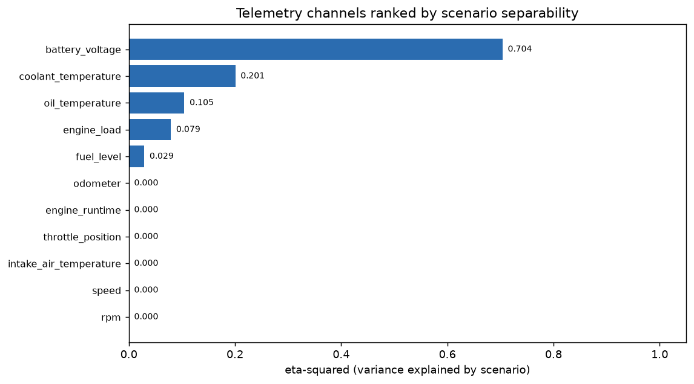
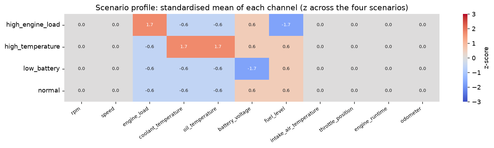
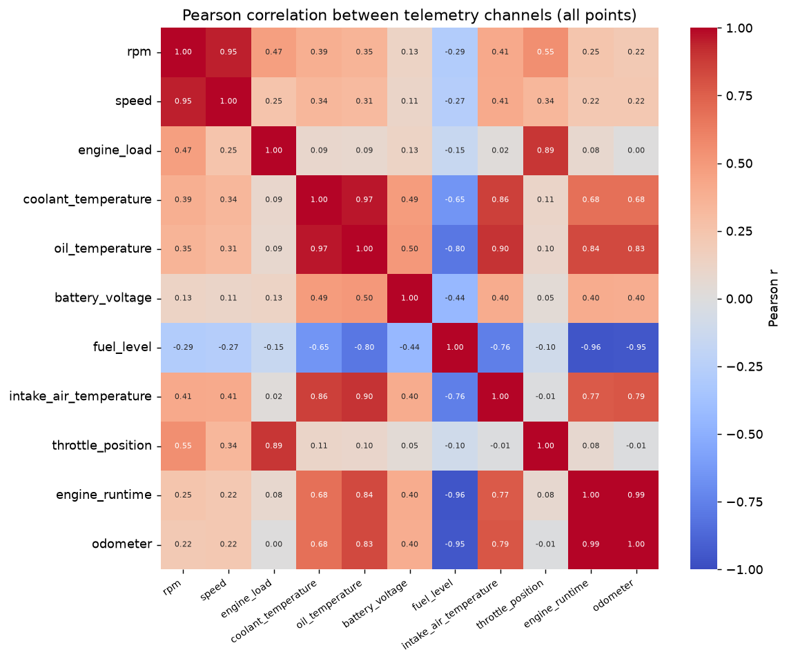
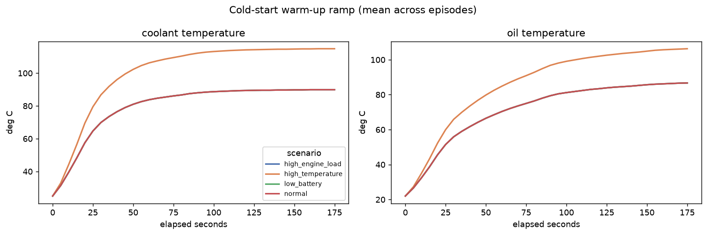
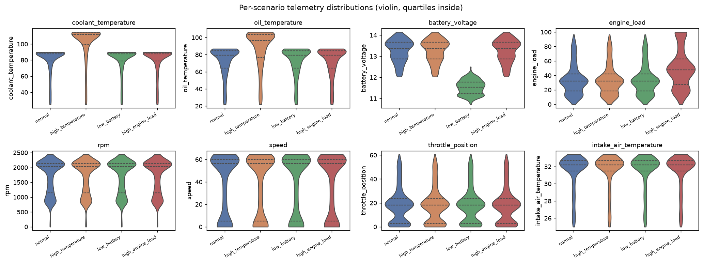
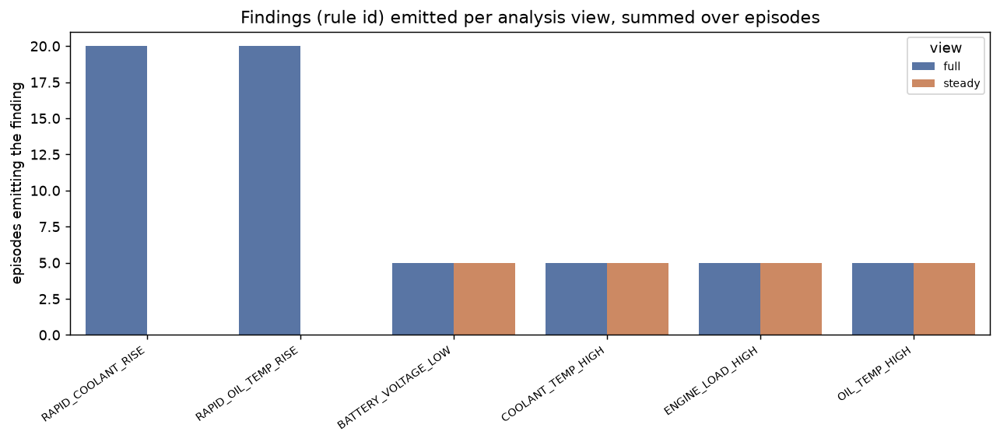
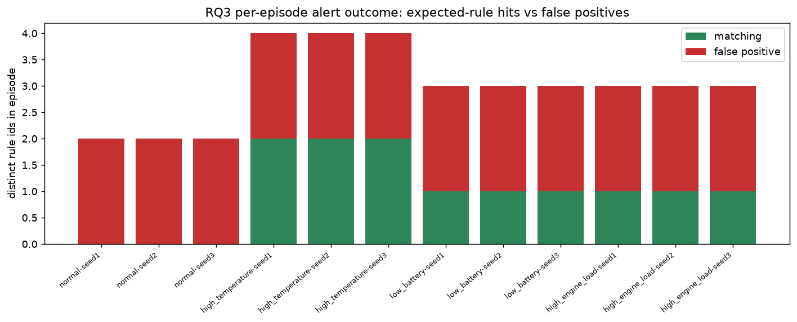
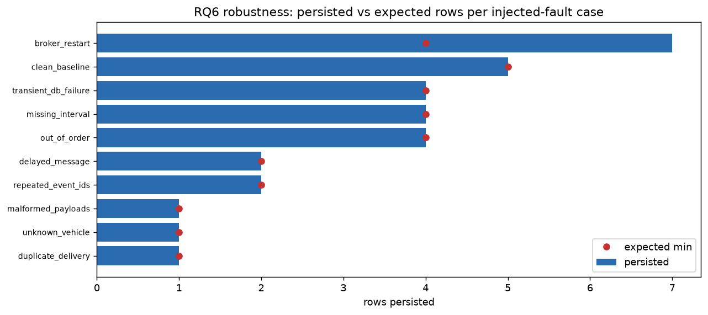

# Exploratory Data Analysis — Digital Twin evaluation

**Provenance: SIMULATED telemetry + MEASURED pipeline behaviour.** This EDA is
**post-hoc and exploratory**; it is *not* the frozen pre-registration and it
computes no scored metric. It only describes the synthetic telemetry and the
already-recorded results, so it can never rewrite a scored finding.

## 1. Inputs & scope

| Input | Value |
| --- | --- |
| dataset_id | synthetic-scenarios-v2 |
| code_revision | 66674bdccc1b8c6d56cd813cc2bd1d0a2e895f31 |
| scope | synthetic-scenarios-v2 (accuracy) + synthetic-pipeline-v1 (pipeline) |
| generated_at | 2026-10-13T16:56:24.194979+00:00 |
| n_episodes | 20 |
| points | 3600 |
| features | 11 |
| pipeline_dataset_id | synthetic-pipeline-v1 |

Input file hashes (sha256):

- `synthetic-scenarios-v2/dataset.json` — 33bb8176d2e2be3939f0f963add8678b7416bc43480a7a8f074f98c78da1bf36 (1879616 bytes)
- `synthetic-scenarios-v2/metrics.json` — 870c55497874f57aa2926de9baccf6fdafc491a8e58479786c0feb71ac28e9ff (65216 bytes)
- `synthetic-pipeline-v1/metrics.json` — 6cc45185f617232d599d67845ce6a7cc84a98c4d302370869761162bf6a5ed04 (117943 bytes)

## 2. Telemetry dataset EDA (SIMULATED)

- Points: 3600 (20 episodes x 180 s x 11 channels).
- Episodes per scenario: {'high_engine_load': 5, 'high_temperature': 5, 'low_battery': 5, 'normal': 5}.
- Points per scenario: {'high_engine_load': 900, 'high_temperature': 900, 'low_battery': 900, 'normal': 900}.
- Constant channels (no variance): none.

### 2.1 Channel summary

| channel | n | min | p50 | p95 | max | mean |
| --- | --- | --- | --- | --- | --- | --- |
| rpm | 3600 | 0.000 | 2031.000 | 2262.600 | 2438.000 | 1688.354 |
| speed | 3600 | 0.000 | 56.400 | 61.900 | 64.400 | 37.704 |
| engine_load | 3600 | 0.000 | 33.600 | 86.600 | 100.000 | 38.258 |
| coolant_temperature | 3600 | 25.000 | 89.100 | 114.600 | 114.900 | 85.206 |
| oil_temperature | 3600 | 22.000 | 81.400 | 104.200 | 106.400 | 75.284 |
| battery_voltage | 3600 | 10.720 | 13.030 | 13.950 | 14.150 | 12.829 |
| fuel_level | 3600 | 74.950 | 74.980 | 75.000 | 75.000 | 74.978 |
| intake_air_temperature | 3600 | 25.000 | 32.200 | 33.200 | 33.400 | 31.390 |
| throttle_position | 3600 | 0.000 | 18.100 | 50.000 | 60.500 | 18.416 |
| engine_runtime | 3600 | 0.000 | 89.000 | 170.000 | 179.000 | 89.500 |
| odometer | 3600 | 45231.700 | 45232.468 | 45233.436 | 45233.586 | 45232.564 |

### 2.2 Scenario separability (one-way eta-squared)

Fraction of each channel's variance explained by the injected scenario.
Descriptive effect size only — not a significance test.

| channel | eta-squared |
| --- | --- |
| battery_voltage | 0.704 |
| coolant_temperature | 0.201 |
| oil_temperature | 0.105 |
| engine_load | 0.079 |
| fuel_level | 0.029 |
| rpm | 0.000 |
| speed | 0.000 |
| intake_air_temperature | 0.000 |
| throttle_position | 0.000 |
| engine_runtime | 0.000 |
| odometer | 0.000 |

### 2.3 Strongest channel correlations

| pair | r |
| --- | --- |
| engine_runtime ~ odometer | 0.993 |
| coolant_temperature ~ oil_temperature | 0.968 |
| fuel_level ~ engine_runtime | -0.958 |
| fuel_level ~ odometer | -0.953 |
| rpm ~ speed | 0.948 |
| oil_temperature ~ intake_air_temperature | 0.899 |
| engine_load ~ throttle_position | 0.892 |
| coolant_temperature ~ intake_air_temperature | 0.863 |

### 2.4 Warm-up ramp observation

On the `normal` scenario the mean coolant temperature rises from ~25.0 deg C at t=0 to ~89.9 deg C by t=175 s. A cold start is itself a rapid rise, which is why the `RAPID_*` rules fire during warm-up (see fig04 and RQ1 `full` view).

## 3. RQ1 — detection (from the frozen accuracy run)

| view | accuracy | macro-F1 | weighted-F1 |
| --- | --- | --- | --- |
| steady | 1.000 | 1.000 | 1.000 |
| full | 0.250 | 0.100 | 0.100 |

## 4. RQ2 — health assessment (ordinal only)

| view | AUC(anomaly vs normal) | AUC(thermal vs non-thermal) |
| --- | --- | --- |
| steady | 1.000 | 1.000 |
| full | 1.000 | 1.000 |

Health score by family (steady / full medians):

| family | steady median | full median |
| --- | --- | --- |
| none | 100.000 | 80.000 |
| thermal | 60.000 | 60.000 |
| electrical | 90.000 | 70.000 |
| engine_load | 90.000 | 70.000 |

## 5. RQ3 — alert lifecycle (live path)

| metric | value |
| --- | --- |
| episodes | 12 |
| episode recall | 1.000 |
| episode precision | 0.750 |
| expected-rule recall | 1.000 (12/12) |
| alerts (matching / false positive) | 12 / 24 |
| alert precision | 0.333 |
| false alarms per vehicle-hour | 40.000 |
| duplicate alert rows | 0 |
| provisional / definitive at create | 30 / 6 |

### 5.1 Per-episode alert outcome

| episode | scenario | reference | detected | matching | false positive |
| --- | --- | --- | --- | --- | --- |
| normal-seed1 | normal | none | no | 0 | 2 |
| normal-seed2 | normal | none | no | 0 | 2 |
| normal-seed3 | normal | none | no | 0 | 2 |
| high_temperature-seed1 | high_temperature | thermal | yes | 2 | 2 |
| high_temperature-seed2 | high_temperature | thermal | yes | 2 | 2 |
| high_temperature-seed3 | high_temperature | thermal | yes | 2 | 2 |
| low_battery-seed1 | low_battery | electrical | yes | 1 | 2 |
| low_battery-seed2 | low_battery | electrical | yes | 1 | 2 |
| low_battery-seed3 | low_battery | electrical | yes | 1 | 2 |
| high_engine_load-seed1 | high_engine_load | engine_load | yes | 1 | 2 |
| high_engine_load-seed2 | high_engine_load | engine_load | yes | 1 | 2 |
| high_engine_load-seed3 | high_engine_load | engine_load | yes | 1 | 2 |

### 5.2 Recovery

| scenario | expected rules | resolved rules | TTR (s) |
| --- | --- | --- | --- |
| high_temperature | COOLANT_TEMP_HIGH, OIL_TEMP_HIGH | COOLANT_TEMP_HIGH, OIL_TEMP_HIGH | 30.000 |
| low_battery | BATTERY_VOLTAGE_LOW | BATTERY_VOLTAGE_LOW | 30.000 |
| high_engine_load | ENGINE_LOAD_HIGH | ENGINE_LOAD_HIGH | 30.000 |

## 6. RQ4 — pipeline latency (MEASURED)

| stage | n | min | p50 | p95 | max | mean |
| --- | --- | --- | --- | --- | --- | --- |
| publish to persisted row (ms) | 180 | 2.482 | 3.886 | 6.763 | 8.267 | 4.364 |
| engine analyse (ms) | 180 | 0.349 | 1.201 | 2.016 | 3.137 | 1.245 |
| monitor pass (ms) | 180 | 7.403 | 16.063 | 22.928 | 32.900 | 16.491 |
| publish to alert (ms) | 9 | 17.906 | 21.837 | n/a | 54.309 | 29.925 |

Compute latency from the accuracy run: steady p50 1.395 ms, full p50 3.697 ms.

## 7. RQ6 — robustness (injected faults)

Passed 10/10 injected-fault cases.

| case | persisted | expected | passed |
| --- | --- | --- | --- |
| clean_baseline | 5 | 5..5 | yes |
| duplicate_delivery | 1 | 1..1 | yes |
| repeated_event_ids | 2 | 2..2 | yes |
| out_of_order | 4 | 4..4 | yes |
| delayed_message | 2 | 2..2 | yes |
| missing_interval | 4 | 4..4 | yes |
| malformed_payloads | 1 | 1..1 | yes |
| unknown_vehicle | 1 | 1..1 | yes |
| transient_db_failure | 4 | 4..4 | yes |
| broker_restart | 7 | 4..1000 | yes |

## 8. Cross-cutting observations (descriptive)

- The rapid-rise rules fire on the plain warm-up ramp in every view that
  includes the ramp; the `steady` view (ramp excluded) is clean. This is the
  same cold-start false-positive mechanism reported in the alert results.
- Between-scenario separability is concentrated in a few channels (see the
  eta-squared ranking); most channels overlap heavily across scenarios.
- Health score and status move together with the emitted findings, so the
  status distribution is descriptive and partly circular, not independent.
- Latency distributions are right-skewed; medians are the honest summary and
  p95/p99 are only meaningful where n is large enough.

## 9. Figure index

### fig01_feature_separability.png

Channels ranked by scenario-explained variance (eta-squared).

### fig02_scenario_profile.png

Standardised per-scenario channel means.

### fig03_correlation.png

Pearson correlation between channels.

### fig04_warmup.png

Cold-start warm-up ramp (coolant & oil temperature).

### fig05_feature_distributions.png

Per-scenario telemetry distributions.

### fig06_health_scores.png

Health score by injected family and view.

### fig07_rq1_confusion.png

RQ1 detection confusion by view.

### fig08_findings.png

Findings emitted per view.

### fig09_latency.png

Pipeline latency distributions.

### fig10_alert_outcomes.png

RQ3 per-episode alert outcomes.

### fig11_robustness.png

RQ6 persisted vs expected rows.

## 10. Limitations

- Telemetry is **simulated** by the in-repo generator; this is not real data.
- Reference labels are the injected scenarios, not independent sensor labels.
- The EDA is descriptive: no hypothesis test is applied and no p-value is
  reported; differences between groups are not claimed to be significant.
- EDA is explicitly outside the frozen pre-registration and must never be
  cited as a scored result.

